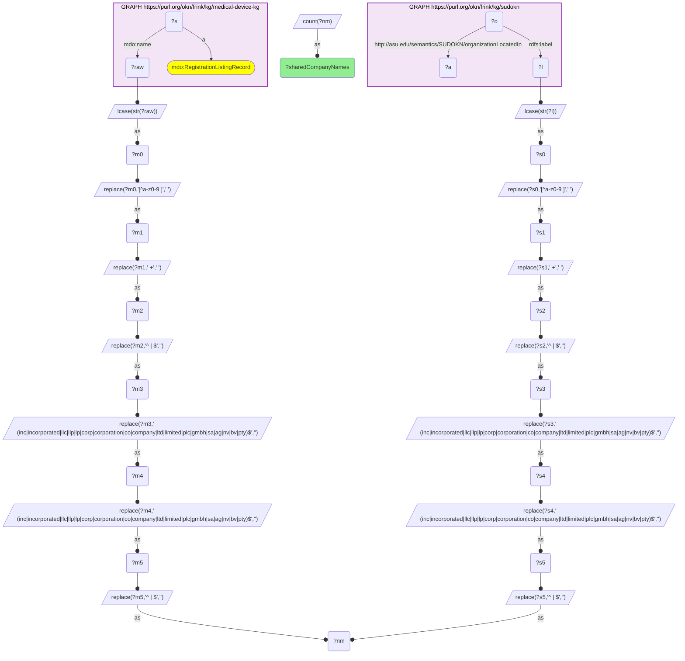
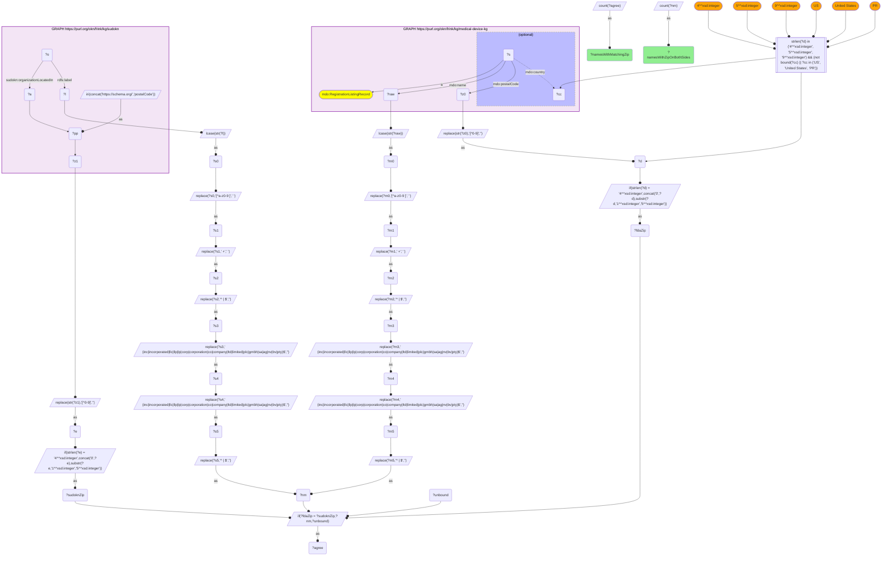
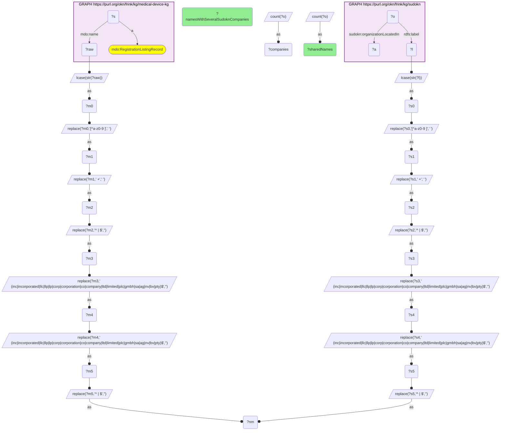

# I06-Q2: 364 shared company names, 256 of them confirmed by an independent ZIP match

- **Date:** 2026-11-03
- **Model:** claude-opus-5-5
- **SPARQL endpoint:** https://apps.okn.us/federation/sparql
- **Generated by:** mcp-okn v0.3.0 (build f9c4776)
- **Contents:** 3 queries · 3 query diagrams

## Knowledge graphs used

- `medical-device-kg` — <https://purl.org/okn/frink/kg/medical-device-kg>
- `sudokn` — <https://purl.org/okn/frink/kg/sudokn>

## Conversation

👤 **User**

Same crosswalk, coverage angle: how many FDA device-establishment names match a SUDOKN manufacturer, and how many of those matches are confirmed by both graphs reporting the same ZIP?

---

🧠 **Assistant**

**364 shared company names, and 256 of them are ZIP-confirmed.**

| Measure | Count | Query |
|---|---|---|
| **Shared normalized names** (FDA establishment ↔ SUDOKN manufacturer) | **364** | 1 |
| … where both sides also carry a US ZIP | 322 | 2 |
| … **where at least one FDA ZIP equals a SUDOKN ZIP for that name** | **256 (79.5% of testable)** | 2 |
| Shared names that map to more than one SUDOKN company | 30 (8.2%) | 3 |

**Why the ZIP column is the whole argument.** A name match on its own is weak evidence. A name match *plus* both graphs independently reporting the same 5-digit postcode is, for practical purposes, an identity match, and that holds for about four in five of the testable set. This is what makes the crosswalk usable rather than a string coincidence. It is also why the catalogued caveat says: **require ZIP agreement (the 256) for any company-specific claim; use the 364 only at cohort level.**

**A ZIP disagreement is not proof of a false match.** The 66 testable names whose ZIPs disagree mix two cases:
- genuine multi-site firms, registered with the FDA at a different site from the one SUDOKN profiled;
- true collisions on generic or very short names (the "mes" / "ims" kind seen in I06-Q1).

**Method note.** Query 2 joins the two graphs on the normalized name only, the single computed key. Each side carries its own normalized ZIP through its `DISTINCT` sub-SELECT, and agreement is tested after the join. Joining on name *and* ZIP at once, as two computed keys, exceeds the endpoint's memory. FDA ZIPs come from the establishment record's own `mdo:postalCode`, restricted to US records. SUDOKN ZIPs come from `schema:postalCode` on the manufacturer's address node.

## SPARQL queries executed

#### Query 1

_2026-11-04T06:01:23+00:00 · `medical-device-kg`, `sudokn`_

```sparql
PREFIX mdo: <https://bmedesign.org/medical-device-kg/ns/>
PREFIX rdfs: <http://www.w3.org/2000/01/rdf-schema#>
SELECT (COUNT(DISTINCT ?nm) AS ?sharedCompanyNames) WHERE {
  { SELECT DISTINCT ?nm WHERE {
      GRAPH <https://purl.org/okn/frink/kg/medical-device-kg> { ?s a mdo:RegistrationListingRecord ; mdo:name ?raw }
      BIND(LCASE(STR(?raw)) AS ?m0)
      BIND(REPLACE(?m0, "[^a-z0-9 ]", " ") AS ?m1)
      BIND(REPLACE(?m1, " +", " ") AS ?m2)
      BIND(REPLACE(?m2, "^ | $", "") AS ?m3)
      BIND(REPLACE(?m3, " (inc|incorporated|llc|llp|lp|corp|corporation|co|company|ltd|limited|plc|gmbh|sa|ag|nv|bv|pty)$", "") AS ?m4)
      BIND(REPLACE(?m4, " (inc|incorporated|llc|llp|lp|corp|corporation|co|company|ltd|limited|plc|gmbh|sa|ag|nv|bv|pty)$", "") AS ?m5)
      BIND(REPLACE(?m5, "^ | $", "") AS ?nm) } }
  { SELECT DISTINCT ?nm WHERE {
      GRAPH <https://purl.org/okn/frink/kg/sudokn> {
        ?o <http://asu.edu/semantics/SUDOKN/organizationLocatedIn> ?a ; rdfs:label ?l . }
      BIND(LCASE(STR(?l)) AS ?s0)
      BIND(REPLACE(?s0, "[^a-z0-9 ]", " ") AS ?s1)
      BIND(REPLACE(?s1, " +", " ") AS ?s2)
      BIND(REPLACE(?s2, "^ | $", "") AS ?s3)
      BIND(REPLACE(?s3, " (inc|incorporated|llc|llp|lp|corp|corporation|co|company|ltd|limited|plc|gmbh|sa|ag|nv|bv|pty)$", "") AS ?s4)
      BIND(REPLACE(?s4, " (inc|incorporated|llc|llp|lp|corp|corporation|co|company|ltd|limited|plc|gmbh|sa|ag|nv|bv|pty)$", "") AS ?s5)
      BIND(REPLACE(?s5, "^ | $", "") AS ?nm) } }
}
```



_1 row(s)_

| sharedCompanyNames |
| --- |
| 364 |

#### Query 2

_2026-11-04T06:01:24+00:00 · `medical-device-kg`, `sudokn`_

```sparql
PREFIX mdo: <https://bmedesign.org/medical-device-kg/ns/>
PREFIX sudokn: <http://asu.edu/semantics/SUDOKN/>
PREFIX rdfs: <http://www.w3.org/2000/01/rdf-schema#>
SELECT (COUNT(DISTINCT ?nm) AS ?namesWithZipOnBothSides) (COUNT(DISTINCT ?agree) AS ?namesWithMatchingZip) WHERE {
  { SELECT DISTINCT ?nm ?fdaZip WHERE {
      GRAPH <https://purl.org/okn/frink/kg/medical-device-kg> {
        ?s a mdo:RegistrationListingRecord ; mdo:name ?raw ; mdo:postalCode ?z0 OPTIONAL { ?s mdo:country ?cc } }
      BIND(REPLACE(STR(?z0),"[^0-9]","") AS ?d)
      FILTER(STRLEN(?d) IN (4, 5, 9) && (!BOUND(?cc) || ?cc IN ("US", "United States", "PR")))
      BIND(IF(STRLEN(?d)=4, CONCAT("0",?d), SUBSTR(?d,1,5)) AS ?fdaZip)
      BIND(LCASE(STR(?raw)) AS ?m0)
      BIND(REPLACE(?m0, "[^a-z0-9 ]", " ") AS ?m1)
      BIND(REPLACE(?m1, " +", " ") AS ?m2)
      BIND(REPLACE(?m2, "^ | $", "") AS ?m3)
      BIND(REPLACE(?m3, " (inc|incorporated|llc|llp|lp|corp|corporation|co|company|ltd|limited|plc|gmbh|sa|ag|nv|bv|pty)$", "") AS ?m4)
      BIND(REPLACE(?m4, " (inc|incorporated|llc|llp|lp|corp|corporation|co|company|ltd|limited|plc|gmbh|sa|ag|nv|bv|pty)$", "") AS ?m5)
      BIND(REPLACE(?m5, "^ | $", "") AS ?nm) } }
  { SELECT DISTINCT ?nm ?sudoknZip WHERE {
      GRAPH <https://purl.org/okn/frink/kg/sudokn> {
        BIND(IRI(CONCAT('https://schema.org/','postalCode')) AS ?pp)
        ?o sudokn:organizationLocatedIn ?a ; rdfs:label ?l . ?a ?pp ?z1 . }
      BIND(REPLACE(STR(?z1),"[^0-9]","") AS ?e)
      BIND(IF(STRLEN(?e)=4, CONCAT("0",?e), SUBSTR(?e,1,5)) AS ?sudoknZip)
      BIND(LCASE(STR(?l)) AS ?s0)
      BIND(REPLACE(?s0, "[^a-z0-9 ]", " ") AS ?s1)
      BIND(REPLACE(?s1, " +", " ") AS ?s2)
      BIND(REPLACE(?s2, "^ | $", "") AS ?s3)
      BIND(REPLACE(?s3, " (inc|incorporated|llc|llp|lp|corp|corporation|co|company|ltd|limited|plc|gmbh|sa|ag|nv|bv|pty)$", "") AS ?s4)
      BIND(REPLACE(?s4, " (inc|incorporated|llc|llp|lp|corp|corporation|co|company|ltd|limited|plc|gmbh|sa|ag|nv|bv|pty)$", "") AS ?s5)
      BIND(REPLACE(?s5, "^ | $", "") AS ?nm) } }
  BIND(IF(?fdaZip = ?sudoknZip, ?nm, ?unbound) AS ?agree)
}
```



_1 row(s)_

| namesWithZipOnBothSides | namesWithMatchingZip |
| --- | --- |
| 322 | 256 |

#### Query 3

_2026-11-04T06:01:24+00:00 · `medical-device-kg`, `sudokn`_

```sparql
PREFIX mdo: <https://bmedesign.org/medical-device-kg/ns/>
PREFIX sudokn: <http://asu.edu/semantics/SUDOKN/>
PREFIX rdfs: <http://www.w3.org/2000/01/rdf-schema#>
SELECT (COUNT(?nm) AS ?sharedNames) (SUM(IF(?companies > 1, 1, 0)) AS ?namesWithSeveralSudoknCompanies) WHERE {
  { SELECT ?nm (COUNT(DISTINCT ?o) AS ?companies) WHERE {
      { SELECT DISTINCT ?nm WHERE {
          GRAPH <https://purl.org/okn/frink/kg/medical-device-kg> { ?s a mdo:RegistrationListingRecord ; mdo:name ?raw }
          BIND(LCASE(STR(?raw)) AS ?m0)
      BIND(REPLACE(?m0, "[^a-z0-9 ]", " ") AS ?m1)
      BIND(REPLACE(?m1, " +", " ") AS ?m2)
      BIND(REPLACE(?m2, "^ | $", "") AS ?m3)
      BIND(REPLACE(?m3, " (inc|incorporated|llc|llp|lp|corp|corporation|co|company|ltd|limited|plc|gmbh|sa|ag|nv|bv|pty)$", "") AS ?m4)
      BIND(REPLACE(?m4, " (inc|incorporated|llc|llp|lp|corp|corporation|co|company|ltd|limited|plc|gmbh|sa|ag|nv|bv|pty)$", "") AS ?m5)
      BIND(REPLACE(?m5, "^ | $", "") AS ?nm) } }
      { SELECT DISTINCT ?nm ?o WHERE {
          GRAPH <https://purl.org/okn/frink/kg/sudokn> { ?o sudokn:organizationLocatedIn ?a ; rdfs:label ?l . }
          BIND(LCASE(STR(?l)) AS ?s0)
      BIND(REPLACE(?s0, "[^a-z0-9 ]", " ") AS ?s1)
      BIND(REPLACE(?s1, " +", " ") AS ?s2)
      BIND(REPLACE(?s2, "^ | $", "") AS ?s3)
      BIND(REPLACE(?s3, " (inc|incorporated|llc|llp|lp|corp|corporation|co|company|ltd|limited|plc|gmbh|sa|ag|nv|bv|pty)$", "") AS ?s4)
      BIND(REPLACE(?s4, " (inc|incorporated|llc|llp|lp|corp|corporation|co|company|ltd|limited|plc|gmbh|sa|ag|nv|bv|pty)$", "") AS ?s5)
      BIND(REPLACE(?s5, "^ | $", "") AS ?nm) } }
    } GROUP BY ?nm }
}
```



_1 row(s)_

| sharedNames | namesWithSeveralSudoknCompanies |
| --- | --- |
| 364 | 30 |
