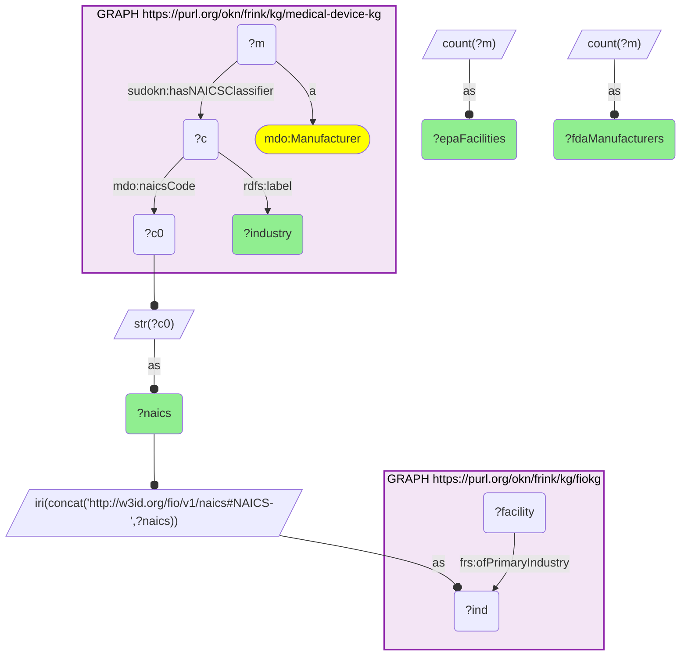

# I08-Q1: the 13 NAICS industries of FDA device manufacturers, with EPA-registered facilities in each (medical-device-kg × fiokg)

- **Date:** 2026-11-03
- **Model:** claude-opus-5-5
- **SPARQL endpoint:** https://apps.okn.us/federation/sparql
- **Generated by:** mcp-okn v0.3.0 (build f9c4776)
- **Contents:** 1 query · 1 query diagram

## Knowledge graphs used

- `medical-device-kg` — <https://purl.org/okn/frink/kg/medical-device-kg>
- `fiokg` — <https://purl.org/okn/frink/kg/fiokg>

## Conversation

👤 **User**

For the NAICS industries FDA medical-device manufacturers are classified under, how many EPA-registered facilities does fiokg list in each?

---

🧠 **Assistant**

**All 13 NAICS industries that FDA medical-device manufacturers are classified under also classify EPA-registered facilities in fiokg, but the two graphs weight those industries very differently.**

| NAICS | Industry | FDA manufacturers (medical-device-kg) | EPA facilities (fiokg, primary industry) |
|---|---|---|---|
| 339112 | Surgical and Medical Instrument Manufacturing | 16,376 | 1,671 |
| 339113 | Surgical Appliance and Supplies Manufacturing | 6,706 | 753 |
| 334510 | Electromedical and Electrotherapeutic Apparatus Manufacturing | 5,046 | 175 |
| 339114 | Dental Equipment and Supplies Manufacturing | 3,993 | 230 |
| 339115 | Ophthalmic Goods Manufacturing | 3,600 | 206 |
| 325413 | In-Vitro Diagnostic Substance Manufacturing | 3,078 | 218 |
| 334517 | Irradiation Apparatus Manufacturing | 2,093 | 108 |
| 334516 | Analytical Laboratory Instrument Manufacturing | 1,237 | 309 |
| 334519 | Other Measuring and Controlling Device Manufacturing | 1,163 | 271 |
| 339116 | Dental Laboratories | 234 | 238 |
| 325412 | Pharmaceutical Preparation Manufacturing | 213 | 2,113 |
| 325414 | Biological Product (except Diagnostic) Manufacturing | 181 | 489 |
| 332721 | Precision Turned Product Manufacturing | 96 | 928 |

**The rankings invert at the edges.**

- **Pharmaceutical preparation** is the largest industry on the EPA side (2,113 facilities) and among the smallest on the FDA device side (213 manufacturers). Precision turned products shows the same pattern (928 against 96).
- **Electromedical apparatus, dental equipment and ophthalmic goods** go the other way: each has thousands of FDA manufacturers but only around 200 EPA facilities.
- **Surgical and medical instruments** is the one industry at the top of both lists.

**What the comparison is, and is not.** This is an industry-level join: the shared key is the six-digit NAICS code, not a company. It says how many EPA-regulated facilities operate in each industry device makers belong to, which is the environmental-regulatory footprint of the sector. It does not say that any particular FDA manufacturer is one of those facilities. The two counts also measure different things. medical-device-kg counts manufacturers known to FDA, and one manufacturer can carry several codes, so the column sums to more than the number of firms. fiokg counts facilities registered with EPA, here by primary industry only.

**How the join works.** Each graph mints its own identifier for a NAICS class, so the IRIs never match. medical-device-kg holds the bare code as a literal (`mdo:naicsCode`) on its classification node. fiokg embeds the code at the end of its industry IRI. Rebuilding fiokg's IRI from the code joins them exactly. The query counts only `mdo:Manufacturer` subjects: medical-device-kg also classifies FDA product codes under the same NAICS nodes, and those are not manufacturers.

## SPARQL queries executed

#### Query 1

_2026-11-04T06:01:25+00:00 · `medical-device-kg`, `fiokg`_

```sparql
PREFIX mdo: <https://bmedesign.org/medical-device-kg/ns/>
PREFIX sudokn: <http://asu.edu/semantics/SUDOKN/>
PREFIX frs: <http://w3id.org/fio/v1/epa-frs#>
PREFIX rdfs: <http://www.w3.org/2000/01/rdf-schema#>
SELECT ?naics ?industry ?fdaManufacturers (COUNT(DISTINCT ?facility) AS ?epaFacilities) WHERE {
  { SELECT ?naics ?industry (COUNT(DISTINCT ?m) AS ?fdaManufacturers) WHERE {
      GRAPH <https://purl.org/okn/frink/kg/medical-device-kg> {
        ?m a mdo:Manufacturer ; sudokn:hasNAICSClassifier ?c .
        ?c mdo:naicsCode ?c0 ; rdfs:label ?industry . }
      BIND(STR(?c0) AS ?naics)
    } GROUP BY ?naics ?industry }
  BIND(IRI(CONCAT('http://w3id.org/fio/v1/naics#NAICS-',?naics)) AS ?ind)
  GRAPH <https://purl.org/okn/frink/kg/fiokg> { ?facility frs:ofPrimaryIndustry ?ind . }
} GROUP BY ?naics ?industry ?fdaManufacturers ORDER BY DESC(?fdaManufacturers)
```



_13 row(s) — showing first 5_

| naics | industry | fdaManufacturers | epaFacilities |
| --- | --- | --- | --- |
| 339112 | Surgical and Medical Instrument Manufacturing | 16376 | 1671 |
| 339113 | Surgical Appliance and Supplies Manufacturing | 6706 | 753 |
| 334510 | Electromedical and Electrotherapeutic Apparatus Manufacturing | 5046 | 175 |
| 339114 | Dental Equipment and Supplies Manufacturing | 3993 | 230 |
| 339115 | Ophthalmic Goods Manufacturing | 3600 | 206 |
