# I11-Q1: FDA device establishments confirmed in SecureChainKG by name and ZIP: Halkey-Roberts 30 products, Grace Manufacturing 29

- **Date:** 2026-11-04
- **Model:** claude-opus-5-5
- **SPARQL endpoint:** https://apps.okn.us/federation/sparql
- **Generated by:** mcp-okn v0.3.0 (build bd8dd05)
- **Contents:** 1 query · 1 query diagram

## Knowledge graphs used

- `medical-device-kg` — <https://purl.org/okn/frink/kg/medical-device-kg>
- `securechainkg` — <https://purl.org/okn/frink/kg/securechainkg>

## Conversation

👤 **User**

medical-device-kg's FDA establishment registrations (`mdo:RegistrationListingRecord`) carry the firm's legal name (`mdo:name`) and a structured address (`mdo:postalCode`, `mdo:country`). SecureChainKG carries US manufacturers (`iof:Manufacturer`) described with SUDOKN vocabulary (products, process capabilities, industries supplied, a site with a ZIP) alongside its hardware/software supply-chain graph. Neither publishes an identifier the other carries. **Crosswalk on company name (normalized, ZIP-confirmed):** which FDA-registered device establishments match a SecureChainKG manufacturer on both normalized name and 5-digit ZIP, and what does SecureChainKG record about what they make and which industries they supply? Rank by products.

---

🧠 **Assistant**

**These are the 15 FDA-registered device establishments with the most products among those that match a SecureChainKG manufacturer on both normalized name and 5-digit ZIP. Halkey-Roberts Corporation leads with 30 recorded products, then Grace Manufacturing (29) and Marcres Metalwerks (24).**

**The join.** Both names are normalized the same way: lower-cased, non-alphanumerics replaced with spaces, whitespace collapsed, and a trailing corporate suffix (inc, llc, corp, co, ltd, …) stripped twice.
- **medical-device-kg ZIP:** taken from the registration record's `mdo:postalCode`, US records only. The `mdo:country` filter keeps foreign postcodes out.
- **SecureChainKG ZIP:** taken from the manufacturer's site through `sudokn:organizationLocatedIn` → `hasZIPcode` → `hasIntegerValue`. A trailing `.0` is stripped first.
- A pair counts only if both name and ZIP agree, so every row below is an identity match, not a name coincidence.

| SecureChainKG manufacturer | ZIP | Products | Process capabilities |
|---|---|---|---|
| Halkey-Roberts Corporation | 33716 | 30 | 2 |
| Grace Manufacturing | 72802 | 29 | 11 |
| Marcres Metalwerks | 60056 | 24 | 14 |
| Bio-Concepts, Inc. | 85034 | 21 | 1 |
| Freeman Manufacturing & Supply Company | 44011 | 21 | 3 |
| Lomont Molding LLC | 52641 | 21 | 6 |
| Metalcraft, Inc. | 53575 | 21 | 3 |
| Casco Bay Molding | 04073 | 20 | 10 |
| LifePort | 98674 | 20 | 0 |
| Peridot Corporation | 94566 | 20 | 10 |
| Rival Technologies | 85023 | 20 | 2 |
| Auer Precision | 85210 | 18 | 7 |
| Biofilm, Inc. | 92081 | 18 | 0 |
| Commercial Plastics | 53144 | 18 | 4 |
| Extol, Inc. | 49464 | 18 | 6 |

**What SecureChainKG adds.** The FDA registration only says the firm is a device establishment. SecureChainKG says what else it makes and which industries it serves.
- **Device-focused firms:** Bio-Concepts and Metalcraft list only Medical Devices and Healthcare; Biofilm lists only Healthcare.
- **Contract manufacturers:** most rows serve many sectors. Lomont Molding lists military, pharmaceutical, telecommunications, transportation, automotive, aerospace, construction and healthcare among others; Grace Manufacturing lists oil and gas, IT, metal production, energy, aerospace and medical devices.
- **No healthcare listed:** Freeman Manufacturing & Supply and Peridot Corporation are FDA-registered but list no healthcare or medical-device industry in SecureChainKG.
- **Process capabilities vary:** from 14 (Marcres Metalwerks) to none recorded (LifePort, Biofilm).

**A data quirk.** SecureChainKG's industry labels come in two cases ('aerospace' and 'Aerospace', 'defense' and 'Defense'). Deduplicate them case-insensitively before counting industries.

## SPARQL queries executed

#### Query 1

_2026-11-04T09:04:58+00:00 · `medical-device-kg`, `securechainkg`_

```sparql
PREFIX mdo: <https://bmedesign.org/medical-device-kg/ns/>
PREFIX sudokn: <http://asu.edu/semantics/SUDOKN/>
PREFIX iof: <https://spec.industrialontologies.org/ontology/core/Core/>
PREFIX rdfs: <http://www.w3.org/2000/01/rdf-schema#>
SELECT ?company ?zip (COUNT(DISTINCT ?product) AS ?products) (COUNT(DISTINCT ?process) AS ?processCapabilities) (GROUP_CONCAT(DISTINCT ?industryLabel; separator=", ") AS ?suppliesTo) WHERE {
  { SELECT DISTINCT ?nm ?o ?zip WHERE {
    { SELECT DISTINCT ?nm ?fdaZip WHERE {
      GRAPH <https://purl.org/okn/frink/kg/medical-device-kg> {
        ?s a mdo:RegistrationListingRecord ; mdo:name ?raw ; mdo:postalCode ?z0 OPTIONAL { ?s mdo:country ?cc } }
      BIND(REPLACE(STR(?z0),"[^0-9]","") AS ?d)
      FILTER(STRLEN(?d) IN (4, 5, 9) && (!BOUND(?cc) || ?cc IN ("US", "United States", "PR")))
      BIND(IF(STRLEN(?d)=4, CONCAT("0",?d), SUBSTR(?d,1,5)) AS ?fdaZip)
      BIND(LCASE(STR(?raw)) AS ?m0)
      BIND(REPLACE(?m0, "[^a-z0-9 ]", " ") AS ?m1)
      BIND(REPLACE(?m1, " +", " ") AS ?m2)
      BIND(REPLACE(?m2, "^ | $", "") AS ?m3)
      BIND(REPLACE(?m3, " (inc|incorporated|llc|llp|lp|corp|corporation|co|company|ltd|limited|plc|gmbh|sa|ag|nv|bv|pty)$", "") AS ?m4)
      BIND(REPLACE(?m4, " (inc|incorporated|llc|llp|lp|corp|corporation|co|company|ltd|limited|plc|gmbh|sa|ag|nv|bv|pty)$", "") AS ?m5)
      BIND(REPLACE(?m5, "^ | $", "") AS ?nm) } }
    { SELECT DISTINCT ?nm ?o ?sccZip WHERE {
      GRAPH <https://purl.org/okn/frink/kg/securechainkg> {
        ?o a iof:Manufacturer ; rdfs:label ?l ; sudokn:organizationLocatedIn ?a . ?a sudokn:hasZIPcode/sudokn:hasIntegerValue ?z1 . }
      BIND(REPLACE(REPLACE(STR(?z1),"[.]0$",""),"[^0-9]","") AS ?e)
      BIND(IF(STRLEN(?e)=4, CONCAT("0",?e), SUBSTR(?e,1,5)) AS ?sccZip)
      BIND(LCASE(STR(?l)) AS ?s0)
      BIND(REPLACE(?s0, "[^a-z0-9 ]", " ") AS ?s1)
      BIND(REPLACE(?s1, " +", " ") AS ?s2)
      BIND(REPLACE(?s2, "^ | $", "") AS ?s3)
      BIND(REPLACE(?s3, " (inc|incorporated|llc|llp|lp|corp|corporation|co|company|ltd|limited|plc|gmbh|sa|ag|nv|bv|pty)$", "") AS ?s4)
      BIND(REPLACE(?s4, " (inc|incorporated|llc|llp|lp|corp|corporation|co|company|ltd|limited|plc|gmbh|sa|ag|nv|bv|pty)$", "") AS ?s5)
      BIND(REPLACE(?s5, "^ | $", "") AS ?nm) } }
    FILTER(?fdaZip = ?sccZip) BIND(?fdaZip AS ?zip)
  } }
  GRAPH <https://purl.org/okn/frink/kg/securechainkg> {
    ?o rdfs:label ?company .
    OPTIONAL { ?o sudokn:manufactures ?product }
    OPTIONAL { ?o sudokn:hasProcessCapability ?process }
    OPTIONAL { ?o sudokn:suppliesToIndustry/rdfs:label ?industryLabel }
  }
} GROUP BY ?company ?zip ORDER BY DESC(?products) ?company LIMIT 15
```

```mermaid
graph TD
classDef projected fill:lightgreen;
classDef literal fill:orange;
classDef iri fill:yellow;
  q0v35("?a")
  q0v14("?cc")
  q0v5("?company"):::projected 
  q0v13("?d")
  q0v32("?e")
  q0v11("?fdaZip")
  q0v38("?industryLabel")
  q0v31("?l")
  q0v21("?m0")
  q0v20("?m1")
  q0v19("?m2")
  q0v18("?m3")
  q0v17("?m4")
  q0v16("?m5")
  q0v15("?nm")
  q0v34("?o")
  q0v37("?process")
  q0v2("?processCapabilities"):::projected 
  q0v36("?product")
  q0v3("?products"):::projected 
  q0v22("?raw")
  q0v24("?s")
  q0v30("?s0")
  q0v29("?s1")
  q0v28("?s2")
  q0v27("?s3")
  q0v26("?s4")
  q0v25("?s5")
  q0v12("?sccZip")
  q0v1("?suppliesTo"):::projected 
  q0v23("?z0")
  q0v33("?z1")
  q0v4("?zip"):::projected 
  q0c1(["4^^xsd:integer"]):::literal 
  q0c2(["5^^xsd:integer"]):::literal 
  q0c3(["9^^xsd:integer"]):::literal 
  q0c6(["PR"]):::literal 
  q0c4(["US"]):::literal 
  q0c5(["United States"]):::literal 
  q0f0[["?fdaZip = ?sccZip"]]
  q0f0 --> q0v11
  q0f0 --> q0v12
  q0f1[["strlen(?d) in ('4^^xsd:integer', '5^^xsd:integer', '9^^xsd:integer') && (not bound(?cc) || ?cc in ('US', 'United States', 'PR'))"]]
  q0c1 --o q0f1
  q0c2 --o q0f1
  q0c3 --o q0f1
  q0c4 --o q0f1
  q0c5 --o q0f1
  q0c6 --o q0f1
  q0f1 --> q0v13
  q0f1 --> q0v14
  subgraph q0graph0["GRAPH https://purl.org/okn/frink/kg/medical-device-kg"]
    style q0graph0 fill:#f3e5f5,stroke:#8e24aa,stroke-width:2px,color:#000;
    q0graph0c2(["mdo:RegistrationListingRecord"]):::iri 
    q0v24 --"a"--> q0graph0c2
    q0v24 --"mdo:name"--> q0v22
    q0v24 --"mdo:postalCode"--> q0v23
    subgraph q0optionalgraph00["(optional)"]
    style q0optionalgraph00 fill:#bbf,stroke-dasharray: 5 5,color:#000;
      q0v24 -."mdo:country".-> q0v14
    end
  end
  q0bind0[/"replace(str(?z0),'#91;^0-9#93;','')"/]
  q0v23 --o q0bind0
  q0bind0 --as--o q0v13
  q0bind1[/"if(strlen(?d) = '4^^xsd:integer',concat('0',?d),substr(?d,'1^^xsd:integer','5^^xsd:integer'))"/]
  q0v13 --o q0bind1
  q0bind1 --as--o q0v11
  q0bind2[/"lcase(str(?raw))"/]
  q0v22 --o q0bind2
  q0bind2 --as--o q0v21
  q0bind3[/"replace(?m0,'#91;^a-z0-9 #93;',' ')"/]
  q0v21 --o q0bind3
  q0bind3 --as--o q0v20
  q0bind4[/"replace(?m1,' +',' ')"/]
  q0v20 --o q0bind4
  q0bind4 --as--o q0v19
  q0bind5[/"replace(?m2,'^ | $','')"/]
  q0v19 --o q0bind5
  q0bind5 --as--o q0v18
  q0bind6[/"replace(?m3,' (inc|incorporated|llc|llp|lp|corp|corporation|co|company|ltd|limited|plc|gmbh|sa|ag|nv|bv|pty)$','')"/]
  q0v18 --o q0bind6
  q0bind6 --as--o q0v17
  q0bind7[/"replace(?m4,' (inc|incorporated|llc|llp|lp|corp|corporation|co|company|ltd|limited|plc|gmbh|sa|ag|nv|bv|pty)$','')"/]
  q0v17 --o q0bind7
  q0bind7 --as--o q0v16
  q0bind8[/"replace(?m5,'^ | $','')"/]
  q0v16 --o q0bind8
  q0bind8 --as--o q0v15
  subgraph q0graph1["GRAPH https://purl.org/okn/frink/kg/securechainkg"]
    style q0graph1 fill:#f3e5f5,stroke:#8e24aa,stroke-width:2px,color:#000;
    q0graph1c2(["iof:Manufacturer"]):::iri 
    q0v34 --"a"--> q0graph1c2
    q0v34 --"sudokn:organizationLocatedIn"--> q0v35
    q0v34 --"rdfs:label"--> q0v31
    q0v35 --"sudokn:hasZIPcode/sudokn:hasIntegerValue"--> q0v33
  end
  q0bind9[/"replace(replace(str(?z1),'#91;.#93;0$',''),'#91;^0-9#93;','')"/]
  q0v33 --o q0bind9
  q0bind9 --as--o q0v32
  q0bind10[/"if(strlen(?e) = '4^^xsd:integer',concat('0',?e),substr(?e,'1^^xsd:integer','5^^xsd:integer'))"/]
  q0v32 --o q0bind10
  q0bind10 --as--o q0v12
  q0bind11[/"lcase(str(?l))"/]
  q0v31 --o q0bind11
  q0bind11 --as--o q0v30
  q0bind12[/"replace(?s0,'#91;^a-z0-9 #93;',' ')"/]
  q0v30 --o q0bind12
  q0bind12 --as--o q0v29
  q0bind13[/"replace(?s1,' +',' ')"/]
  q0v29 --o q0bind13
  q0bind13 --as--o q0v28
  q0bind14[/"replace(?s2,'^ | $','')"/]
  q0v28 --o q0bind14
  q0bind14 --as--o q0v27
  q0bind15[/"replace(?s3,' (inc|incorporated|llc|llp|lp|corp|corporation|co|company|ltd|limited|plc|gmbh|sa|ag|nv|bv|pty)$','')"/]
  q0v27 --o q0bind15
  q0bind15 --as--o q0v26
  q0bind16[/"replace(?s4,' (inc|incorporated|llc|llp|lp|corp|corporation|co|company|ltd|limited|plc|gmbh|sa|ag|nv|bv|pty)$','')"/]
  q0v26 --o q0bind16
  q0bind16 --as--o q0v25
  q0bind17[/"replace(?s5,'^ | $','')"/]
  q0v25 --o q0bind17
  q0bind17 --as--o q0v15
  q0bind18[/"?fdaZip"/]
  q0v11 --o q0bind18
  q0bind18 --as--o q0v4
  subgraph q0graph2["GRAPH https://purl.org/okn/frink/kg/securechainkg"]
    style q0graph2 fill:#f3e5f5,stroke:#8e24aa,stroke-width:2px,color:#000;
    q0v34 --"rdfs:label"--> q0v5
    subgraph q0optionalgraph21["(optional)"]
    style q0optionalgraph21 fill:#bbf,stroke-dasharray: 5 5,color:#000;
      q0v34 -."sudokn:manufactures".-> q0v36
    end
    subgraph q0optionalgraph22["(optional)"]
    style q0optionalgraph22 fill:#bbf,stroke-dasharray: 5 5,color:#000;
      q0v34 -."sudokn:hasProcessCapability".-> q0v37
    end
    subgraph q0optionalgraph23["(optional)"]
    style q0optionalgraph23 fill:#bbf,stroke-dasharray: 5 5,color:#000;
      q0v34 -."sudokn:suppliesToIndustry/rdfs:label".-> q0v38
    end
  end
  q0bind19[/"count(?product)"/]
  q0bind19 --as--o q0v3
  q0bind20[/"count(?process)"/]
  q0bind20 --as--o q0v2
  q0bind21[/"group_concat(?industryLabel)"/]
  q0bind21 --as--o q0v1
```



_15 row(s) — showing first 5_

| company | zip | products | processCapabilities | suppliesTo |
| --- | --- | --- | --- | --- |
| Halkey-Roberts Corporation | 33716 | 30 | 2 | aerospace, Aerospace, Healthcare, Defense, defense, Automotive |
| Grace Manufacturing | 72802 | 29 | 11 | oil and gas, Oil And Gas, Plastic And Rubber, Information Technology, Metal Production, Medical Devices, Energy, aerospace, Aerospace, Automotive |
| Marcres Metalwerks | 60056 | 24 | 14 | transportation, Healthcare, Food, food, electronic product, Electronic Product, pharmaceutical, Pharmaceutical, Transportation |
| Bio-Concepts, Inc. | 85034 | 21 | 1 | Medical Devices, Healthcare |
| Freeman Manufacturing & Supply Company | 44011 | 21 | 3 | Automotive, Metal Production, Plastic And Rubber, Aerospace, aerospace |
