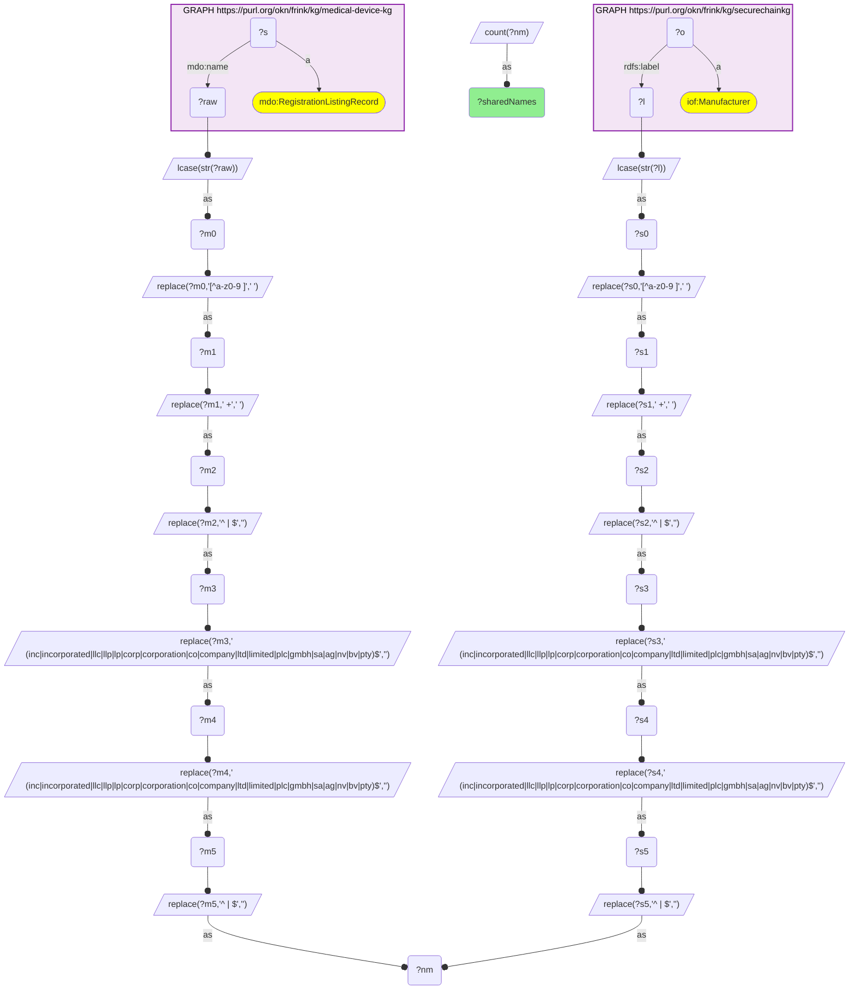
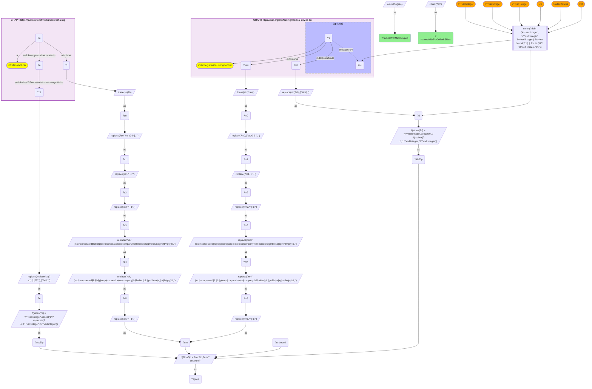
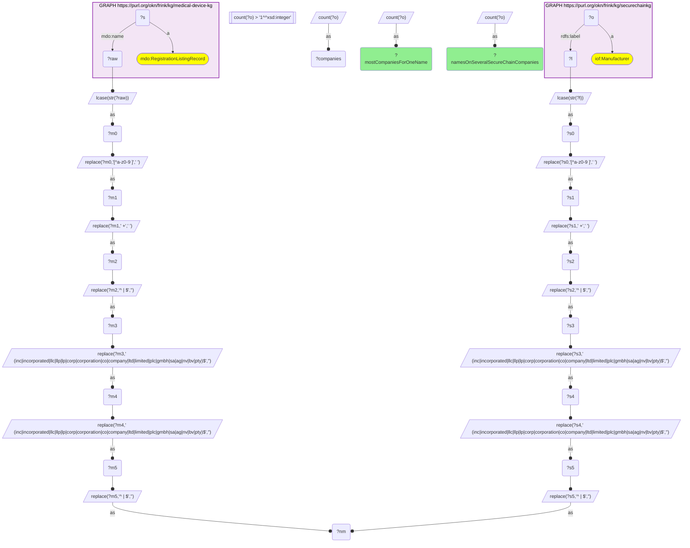
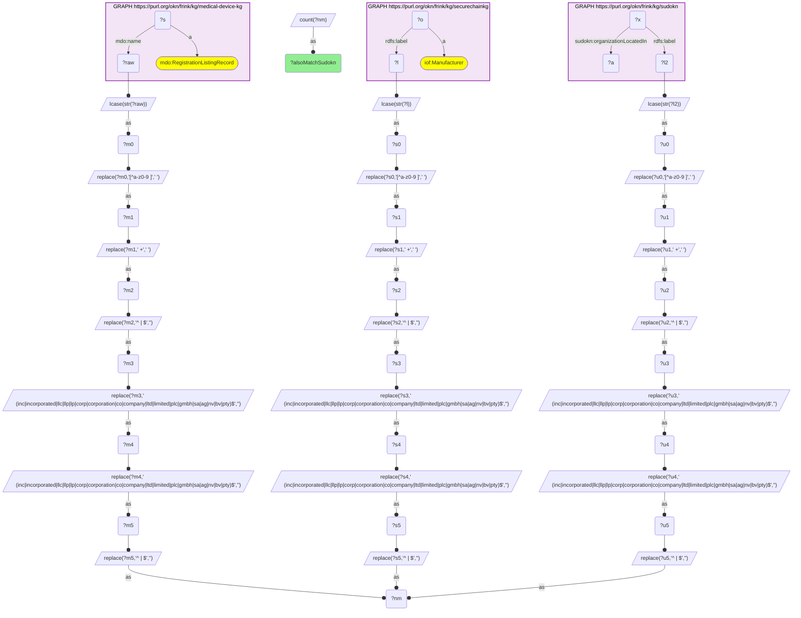

# I11-Q2: 195 shared company names, 80 ZIP-confirmed (61% of the 131 testable); 116 of the 195 also match SUDOKN

- **Date:** 2026-11-04
- **Model:** claude-opus-5-5
- **SPARQL endpoint:** https://apps.okn.us/federation/sparql
- **Generated by:** mcp-okn v0.3.0 (build bd8dd05)
- **Contents:** 4 queries · 4 query diagrams

## Knowledge graphs used

- `medical-device-kg` — <https://purl.org/okn/frink/kg/medical-device-kg>
- `securechainkg` — <https://purl.org/okn/frink/kg/securechainkg>
- `sudokn` — <https://purl.org/okn/frink/kg/sudokn>

## Conversation

👤 **User**

medical-device-kg's FDA establishment registrations (`mdo:RegistrationListingRecord`) carry the firm's legal name (`mdo:name`) and a structured address (`mdo:postalCode`, `mdo:country`). SecureChainKG carries US manufacturers (`iof:Manufacturer`) described with SUDOKN vocabulary (products, process capabilities, industries supplied, a site with a ZIP) alongside its hardware/software supply-chain graph. Neither publishes an identifier the other carries. **Crosswalk on company name:** after legal-suffix normalization, how many names do the two graphs share; how many of those are confirmed by both graphs reporting the same ZIP; how many names map to more than one SecureChainKG company; and how many of the shared names would the existing medical-device-kg × SUDOKN name bridge reach anyway?

---

🧠 **Assistant**

**195 normalized company names are shared. 80 of the 131 names that carry a ZIP on both sides agree on it (61%). 116 of the 195 would also be reached by the existing medical-device-kg × SUDOKN name bridge.**

**Shared names (query 1).** The left side is medical-device-kg's FDA establishment registrations (`mdo:name`); the right side is SecureChainKG's `iof:Manufacturer` labels. After legal-suffix normalization (lower-case, punctuation to spaces, collapse, strip a trailing inc/llc/corp/co/ltd… twice) they share **195** names. This is the crosswalk's skeleton count.

**ZIP confirmation (query 2).** The query joins on the normalized name only and carries each side's 5-digit ZIP through its own sub-select. It then tests agreement after the join; joining on two computed keys at once overloads the endpoint.
- **131** of the 195 names have a US ZIP on both sides.
- **80** of those agree on at least one ZIP (61.1%).
- Same name and same ZIP is an identity match. That is lower than the SUDOKN bridge's confirmation rate (I06-Q2), so give more weight to the confirmed subset here.

**Multiplicity (query 3).** 7 of the 195 names correspond to more than one SecureChainKG manufacturer; the most for a single name is 4. These are generic or multi-site names, and on them a name match alone cannot tell which company is meant.

**Overlap with the SUDOKN bridge (query 4).** SecureChainKG describes its manufacturers in SUDOKN vocabulary (query 2 reaches the ZIP through `sudokn:organizationLocatedIn`). **116** of the 195 shared names also match a SUDOKN manufacturer. The other **79** reach SecureChainKG only, which is what this crosswalk adds. Through it they also connect to SecureChainKG's hardware and software supply-chain graph.

**Use.**
- For a claim about a specific company, require ZIP agreement (the 80), or check the pair by hand.
- Use the 195 for cohort-level questions only.
- Two failure modes remain:
  - **Generic names**, which several unrelated firms share.
  - **Multi-site firms**, where a ZIP mismatch can be the same company registered at a different site.

## SPARQL queries executed

#### Query 1

_2026-11-04T09:04:58+00:00 · `medical-device-kg`, `securechainkg`_

```sparql
PREFIX mdo: <https://bmedesign.org/medical-device-kg/ns/>
PREFIX sudokn: <http://asu.edu/semantics/SUDOKN/>
PREFIX iof: <https://spec.industrialontologies.org/ontology/core/Core/>
PREFIX rdfs: <http://www.w3.org/2000/01/rdf-schema#>
SELECT (COUNT(DISTINCT ?nm) AS ?sharedNames) WHERE {
  { SELECT DISTINCT ?nm WHERE { GRAPH <https://purl.org/okn/frink/kg/medical-device-kg> { ?s a mdo:RegistrationListingRecord ; mdo:name ?raw }
      BIND(LCASE(STR(?raw)) AS ?m0)
      BIND(REPLACE(?m0, "[^a-z0-9 ]", " ") AS ?m1)
      BIND(REPLACE(?m1, " +", " ") AS ?m2)
      BIND(REPLACE(?m2, "^ | $", "") AS ?m3)
      BIND(REPLACE(?m3, " (inc|incorporated|llc|llp|lp|corp|corporation|co|company|ltd|limited|plc|gmbh|sa|ag|nv|bv|pty)$", "") AS ?m4)
      BIND(REPLACE(?m4, " (inc|incorporated|llc|llp|lp|corp|corporation|co|company|ltd|limited|plc|gmbh|sa|ag|nv|bv|pty)$", "") AS ?m5)
      BIND(REPLACE(?m5, "^ | $", "") AS ?nm) } }
  { SELECT DISTINCT ?nm WHERE { GRAPH <https://purl.org/okn/frink/kg/securechainkg> { ?o a iof:Manufacturer ; rdfs:label ?l }
      BIND(LCASE(STR(?l)) AS ?s0)
      BIND(REPLACE(?s0, "[^a-z0-9 ]", " ") AS ?s1)
      BIND(REPLACE(?s1, " +", " ") AS ?s2)
      BIND(REPLACE(?s2, "^ | $", "") AS ?s3)
      BIND(REPLACE(?s3, " (inc|incorporated|llc|llp|lp|corp|corporation|co|company|ltd|limited|plc|gmbh|sa|ag|nv|bv|pty)$", "") AS ?s4)
      BIND(REPLACE(?s4, " (inc|incorporated|llc|llp|lp|corp|corporation|co|company|ltd|limited|plc|gmbh|sa|ag|nv|bv|pty)$", "") AS ?s5)
      BIND(REPLACE(?s5, "^ | $", "") AS ?nm) } }
}
```



_1 row(s)_

| sharedNames |
| --- |
| 195 |

#### Query 2

_2026-11-04T09:04:59+00:00 · `medical-device-kg`, `securechainkg`_

```sparql
PREFIX mdo: <https://bmedesign.org/medical-device-kg/ns/>
PREFIX sudokn: <http://asu.edu/semantics/SUDOKN/>
PREFIX iof: <https://spec.industrialontologies.org/ontology/core/Core/>
PREFIX rdfs: <http://www.w3.org/2000/01/rdf-schema#>
SELECT (COUNT(DISTINCT ?nm) AS ?namesWithZipOnBothSides) (COUNT(DISTINCT ?agree) AS ?namesWithMatchingZip) WHERE {
  { SELECT DISTINCT ?nm ?fdaZip WHERE {
      GRAPH <https://purl.org/okn/frink/kg/medical-device-kg> {
        ?s a mdo:RegistrationListingRecord ; mdo:name ?raw ; mdo:postalCode ?z0 OPTIONAL { ?s mdo:country ?cc } }
      BIND(REPLACE(STR(?z0),"[^0-9]","") AS ?d)
      FILTER(STRLEN(?d) IN (4, 5, 9) && (!BOUND(?cc) || ?cc IN ("US", "United States", "PR")))
      BIND(IF(STRLEN(?d)=4, CONCAT("0",?d), SUBSTR(?d,1,5)) AS ?fdaZip)
      BIND(LCASE(STR(?raw)) AS ?m0)
      BIND(REPLACE(?m0, "[^a-z0-9 ]", " ") AS ?m1)
      BIND(REPLACE(?m1, " +", " ") AS ?m2)
      BIND(REPLACE(?m2, "^ | $", "") AS ?m3)
      BIND(REPLACE(?m3, " (inc|incorporated|llc|llp|lp|corp|corporation|co|company|ltd|limited|plc|gmbh|sa|ag|nv|bv|pty)$", "") AS ?m4)
      BIND(REPLACE(?m4, " (inc|incorporated|llc|llp|lp|corp|corporation|co|company|ltd|limited|plc|gmbh|sa|ag|nv|bv|pty)$", "") AS ?m5)
      BIND(REPLACE(?m5, "^ | $", "") AS ?nm) } }
  { SELECT DISTINCT ?nm ?o ?sccZip WHERE {
      GRAPH <https://purl.org/okn/frink/kg/securechainkg> {
        ?o a iof:Manufacturer ; rdfs:label ?l ; sudokn:organizationLocatedIn ?a . ?a sudokn:hasZIPcode/sudokn:hasIntegerValue ?z1 . }
      BIND(REPLACE(REPLACE(STR(?z1),"[.]0$",""),"[^0-9]","") AS ?e)
      BIND(IF(STRLEN(?e)=4, CONCAT("0",?e), SUBSTR(?e,1,5)) AS ?sccZip)
      BIND(LCASE(STR(?l)) AS ?s0)
      BIND(REPLACE(?s0, "[^a-z0-9 ]", " ") AS ?s1)
      BIND(REPLACE(?s1, " +", " ") AS ?s2)
      BIND(REPLACE(?s2, "^ | $", "") AS ?s3)
      BIND(REPLACE(?s3, " (inc|incorporated|llc|llp|lp|corp|corporation|co|company|ltd|limited|plc|gmbh|sa|ag|nv|bv|pty)$", "") AS ?s4)
      BIND(REPLACE(?s4, " (inc|incorporated|llc|llp|lp|corp|corporation|co|company|ltd|limited|plc|gmbh|sa|ag|nv|bv|pty)$", "") AS ?s5)
      BIND(REPLACE(?s5, "^ | $", "") AS ?nm) } }
  BIND(IF(?fdaZip = ?sccZip, ?nm, ?unbound) AS ?agree)
}
```



_1 row(s)_

| namesWithZipOnBothSides | namesWithMatchingZip |
| --- | --- |
| 131 | 80 |

#### Query 3

_2026-11-04T09:04:59+00:00 · `medical-device-kg`, `securechainkg`_

```sparql
PREFIX mdo: <https://bmedesign.org/medical-device-kg/ns/>
PREFIX sudokn: <http://asu.edu/semantics/SUDOKN/>
PREFIX iof: <https://spec.industrialontologies.org/ontology/core/Core/>
PREFIX rdfs: <http://www.w3.org/2000/01/rdf-schema#>
SELECT (COUNT(*) AS ?namesOnSeveralSecureChainCompanies) (MAX(?companies) AS ?mostCompaniesForOneName) WHERE {
  { SELECT ?nm (COUNT(DISTINCT ?o) AS ?companies) WHERE {
    { SELECT DISTINCT ?nm WHERE { GRAPH <https://purl.org/okn/frink/kg/medical-device-kg> { ?s a mdo:RegistrationListingRecord ; mdo:name ?raw }
      BIND(LCASE(STR(?raw)) AS ?m0)
      BIND(REPLACE(?m0, "[^a-z0-9 ]", " ") AS ?m1)
      BIND(REPLACE(?m1, " +", " ") AS ?m2)
      BIND(REPLACE(?m2, "^ | $", "") AS ?m3)
      BIND(REPLACE(?m3, " (inc|incorporated|llc|llp|lp|corp|corporation|co|company|ltd|limited|plc|gmbh|sa|ag|nv|bv|pty)$", "") AS ?m4)
      BIND(REPLACE(?m4, " (inc|incorporated|llc|llp|lp|corp|corporation|co|company|ltd|limited|plc|gmbh|sa|ag|nv|bv|pty)$", "") AS ?m5)
      BIND(REPLACE(?m5, "^ | $", "") AS ?nm) } }
    { SELECT DISTINCT ?nm ?o WHERE { GRAPH <https://purl.org/okn/frink/kg/securechainkg> { ?o a iof:Manufacturer ; rdfs:label ?l }
      BIND(LCASE(STR(?l)) AS ?s0)
      BIND(REPLACE(?s0, "[^a-z0-9 ]", " ") AS ?s1)
      BIND(REPLACE(?s1, " +", " ") AS ?s2)
      BIND(REPLACE(?s2, "^ | $", "") AS ?s3)
      BIND(REPLACE(?s3, " (inc|incorporated|llc|llp|lp|corp|corporation|co|company|ltd|limited|plc|gmbh|sa|ag|nv|bv|pty)$", "") AS ?s4)
      BIND(REPLACE(?s4, " (inc|incorporated|llc|llp|lp|corp|corporation|co|company|ltd|limited|plc|gmbh|sa|ag|nv|bv|pty)$", "") AS ?s5)
      BIND(REPLACE(?s5, "^ | $", "") AS ?nm) } }
  } GROUP BY ?nm HAVING(COUNT(DISTINCT ?o) > 1) }
}
```



_1 row(s)_

| namesOnSeveralSecureChainCompanies | mostCompaniesForOneName |
| --- | --- |
| 7 | 4 |

#### Query 4

_2026-11-04T09:05:00+00:00 · `medical-device-kg`, `securechainkg`, `sudokn`_

```sparql
PREFIX mdo: <https://bmedesign.org/medical-device-kg/ns/>
PREFIX sudokn: <http://asu.edu/semantics/SUDOKN/>
PREFIX iof: <https://spec.industrialontologies.org/ontology/core/Core/>
PREFIX rdfs: <http://www.w3.org/2000/01/rdf-schema#>
SELECT (COUNT(DISTINCT ?nm) AS ?alsoMatchSudokn) WHERE {
  { SELECT DISTINCT ?nm WHERE { GRAPH <https://purl.org/okn/frink/kg/medical-device-kg> { ?s a mdo:RegistrationListingRecord ; mdo:name ?raw }
      BIND(LCASE(STR(?raw)) AS ?m0)
      BIND(REPLACE(?m0, "[^a-z0-9 ]", " ") AS ?m1)
      BIND(REPLACE(?m1, " +", " ") AS ?m2)
      BIND(REPLACE(?m2, "^ | $", "") AS ?m3)
      BIND(REPLACE(?m3, " (inc|incorporated|llc|llp|lp|corp|corporation|co|company|ltd|limited|plc|gmbh|sa|ag|nv|bv|pty)$", "") AS ?m4)
      BIND(REPLACE(?m4, " (inc|incorporated|llc|llp|lp|corp|corporation|co|company|ltd|limited|plc|gmbh|sa|ag|nv|bv|pty)$", "") AS ?m5)
      BIND(REPLACE(?m5, "^ | $", "") AS ?nm) } }
  { SELECT DISTINCT ?nm WHERE { GRAPH <https://purl.org/okn/frink/kg/securechainkg> { ?o a iof:Manufacturer ; rdfs:label ?l }
      BIND(LCASE(STR(?l)) AS ?s0)
      BIND(REPLACE(?s0, "[^a-z0-9 ]", " ") AS ?s1)
      BIND(REPLACE(?s1, " +", " ") AS ?s2)
      BIND(REPLACE(?s2, "^ | $", "") AS ?s3)
      BIND(REPLACE(?s3, " (inc|incorporated|llc|llp|lp|corp|corporation|co|company|ltd|limited|plc|gmbh|sa|ag|nv|bv|pty)$", "") AS ?s4)
      BIND(REPLACE(?s4, " (inc|incorporated|llc|llp|lp|corp|corporation|co|company|ltd|limited|plc|gmbh|sa|ag|nv|bv|pty)$", "") AS ?s5)
      BIND(REPLACE(?s5, "^ | $", "") AS ?nm) } }
  { SELECT DISTINCT ?nm WHERE { GRAPH <https://purl.org/okn/frink/kg/sudokn> {
        ?x sudokn:organizationLocatedIn ?a ; rdfs:label ?l2 }
      BIND(LCASE(STR(?l2)) AS ?u0)
      BIND(REPLACE(?u0, "[^a-z0-9 ]", " ") AS ?u1)
      BIND(REPLACE(?u1, " +", " ") AS ?u2)
      BIND(REPLACE(?u2, "^ | $", "") AS ?u3)
      BIND(REPLACE(?u3, " (inc|incorporated|llc|llp|lp|corp|corporation|co|company|ltd|limited|plc|gmbh|sa|ag|nv|bv|pty)$", "") AS ?u4)
      BIND(REPLACE(?u4, " (inc|incorporated|llc|llp|lp|corp|corporation|co|company|ltd|limited|plc|gmbh|sa|ag|nv|bv|pty)$", "") AS ?u5)
      BIND(REPLACE(?u5, "^ | $", "") AS ?nm) } }
}
```



_1 row(s)_

| alsoMatchSudokn |
| --- |
| 116 |
