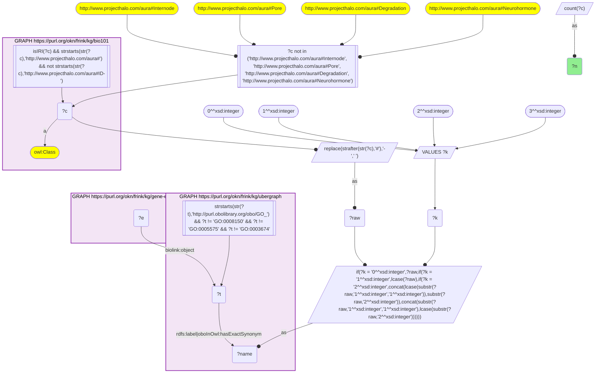
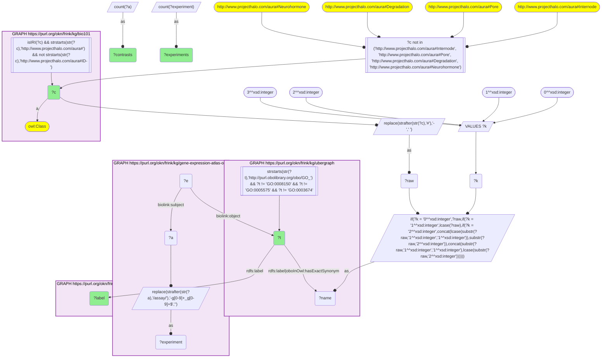

# MF05-Q1: KB Bio 101's processes and structures as Expression Atlas GO enrichments

- **Date:** 2026-11-03
- **Model:** claude-opus-5-5
- **SPARQL endpoint:** https://apps.okn.us/federation/sparql
- **Generated by:** mcp-okn v0.3.0 (build 5f97869)
- **Contents:** 2 queries · 2 query diagrams

## Knowledge graphs used

- `bio101` — <https://purl.org/okn/frink/kg/bio101>
- `ubergraph` — <https://purl.org/okn/frink/kg/ubergraph>
- `gene-expression-atlas-okn` — <https://purl.org/okn/frink/kg/gene-expression-atlas-okn>

## Conversation

👤 **User**

Crosswalk: `bio101` × `gene-expression-atlas-okn` on **GO (bio101 label), bridged through `ubergraph`** (crosswalk `KB18-go-label-bio101-gxa`, verified_count 193). KB Bio 101 is an OWL ontology of an introductory biology textbook: every concept is an `owl:Class` IRI `http://www.projecthalo.com/aura#{Name}` with no `rdfs:label` and no external id, so the concept NAME (local name, hyphens → spaces, four case forms: as-is, all lower-case, first letter lowered, sentence case) is matched as a bound literal against ubergraph `rdfs:label | oboInOwl:hasExactSynonym` on `obo/GO_` terms. Expression Atlas (`gene-expression-atlas-okn`) stores GO enrichment of each differential-expression contrast as a `biolink:Association` whose `biolink:subject` is the contrast (`biolink:Assay`, named `'test' vs 'reference'` on `biolink:name`), whose `biolink:object` is a raw `obo/GO_` IRI, with `wobd:p_value` and `wobd:adj_p_value` (`wobd:direction` is 'up' on every enrichment in this release). The experiment accession is the contrast IRI's prefix (`wobd/assay/E-GEOD-69785-g1_g4` → `E-GEOD-69785`). The GO roots are excluded, and four homonyms by name (Internode, Pore, Degradation, Neurohormone; as KB9).

Research question: which processes and cell structures KB Bio 101 teaches come up as GO terms enriched in Expression Atlas differential-expression contrasts, and in how many contrasts and experiments? Rank the top 40.

Why the join is required: bio101 knows which processes a curriculum teaches; Expression Atlas knows which GO terms change in real experiments. They share no identifier, so only the name → GO bridge through ubergraph joins them.

---

🧠 **Assistant**

**Bridge established (Query 1).** The crosswalk skeleton, run verbatim, returns **193** bio101 concepts. Each concept's name is an exact GO label or exact synonym in ubergraph, *and* its GO term is the `biolink:object` of at least one Expression Atlas enrichment record. This matches the catalogued `verified_count`.

**Ranking (Query 2, top 40).** Contrasts (distinct assay nodes) with the GO term enriched, and experiments (the accession prefix of the assay IRI):

| Rank | bio101 concept | GO (ubergraph label) | Contrasts | Experiments |
|---|---|---|---|---|
| 1 | Proteasome | GO_0000502 (proteasome complex) | 596 | 337 |
| 2 | Kinetochore | GO_0000776 | 492 | 298 |
| 3 | Photosystem-II | GO_0009523 | 453 | 232 |
| 4 | Photosystem-I | GO_0009522 | 438 | 213 |
| 5 | Ribosome | GO_0005840 | 370 | 234 |
| 6 | Chemotaxis | GO_0006935 | 286 | 165 |
| 7 | Small-Ribosomal-Subunit | GO_0015935 | 285 | 193 |
| 8 | Mitotic-Cell-Cycle | GO_0000278 | 283 | 197 |
| 9 | Nucleosome | GO_0000786 | 268 | 194 |
| 10 | Basement-Membrane | GO_0005604 | 257 | 215 |
| 11 | Circadian-Rhythm | GO_0007623 | 238 | 152 |
| 12 | Photosynthesis | GO_0015979 | 233 | 118 |
| 13 | Translation-Initiation | GO_0006413 (translational initiation) | 227 | 157 |
| 14 | Spindle | GO_0005819 | 195 | 129 |
| 15 | Mitotic-Spindle | GO_0072686 | 183 | 121 |
| 16 | Citric-Acid-Cycle | GO_0006099 (tricarboxylic acid cycle) | 175 | 118 |
| 17 | Large-Ribosomal-Subunit | GO_0015934 | 174 | 122 |
| 18 | Translation | GO_0006412 | 149 | 102 |
| 19 | Nuclear-Pore | GO_0005643 | 146 | 108 |
| 20 | Peroxisome | GO_0005777 | 146 | 70 |

Ranks 21–40 run from Antigen-Presentation and Protein-Folding (135 contrasts each), through Immune-Response (130), Electron-Transport-Chain (125), Inflammatory-Response (124), Cell-Division (117), Cell-Cycle (113), Thylakoid (112) and Systemic-Acquired-Resistance (108), down to Phagocytosis (67), Centriole (58) and Bone-Formation → ossification (55).

**Answer.** The textbook topics that change most often in real experiments are the cell's core machinery:

- protein turnover (the proteasome, in 596 contrasts across 337 experiments);
- chromosome segregation and division (kinetochore, mitotic cell cycle, nucleosome, spindle);
- protein synthesis (ribosome and both subunits, translational initiation, translation).

The two photosystems (453 and 438 contrasts) and photosynthesis (233) rank high because Expression Atlas includes many plant experiments. Physiology topics a curriculum teaches separately also recur: chemotaxis, circadian rhythm, the immune and inflammatory responses, and systemic acquired resistance (the plant immune topic).

Caveats:

- This is an exact-name lower bound. The GO roots and four homonyms are excluded (Internode, Pore, Degradation, Neurohormone).
- Every Expression Atlas enrichment record carries `wobd:direction` "up", so the store does not show whether a topic's genes went up or down in a contrast. Only the fact of enrichment is counted.
- Counts pool all species in Expression Atlas.

## SPARQL queries executed

#### Query 1

_2026-11-04T01:00:48+00:00 · `bio101`, `ubergraph`, `gene-expression-atlas-okn`_

```sparql
SELECT (COUNT(DISTINCT ?c) AS ?n) WHERE {
  { SELECT DISTINCT ?c ?t WHERE {
  { SELECT DISTINCT ?c ?name WHERE {
      GRAPH <https://purl.org/okn/frink/kg/bio101> { ?c a <http://www.w3.org/2002/07/owl#Class> .
        FILTER(isIRI(?c) && STRSTARTS(STR(?c),'http://www.projecthalo.com/aura#') && !STRSTARTS(STR(?c),'http://www.projecthalo.com/aura#ID-')) }
      FILTER(?c NOT IN (<http://www.projecthalo.com/aura#Internode>, <http://www.projecthalo.com/aura#Pore>, <http://www.projecthalo.com/aura#Degradation>, <http://www.projecthalo.com/aura#Neurohormone>))  # homonyms (spot-checked 2026-11-03)
      BIND(REPLACE(STRAFTER(STR(?c),'#'),'-',' ') AS ?raw)
      VALUES ?k { 0 1 2 3 }  # as-is, all lower, first letter lowered, sentence case
      BIND(IF(?k = 0, ?raw, IF(?k = 1, LCASE(?raw), IF(?k = 2, CONCAT(LCASE(SUBSTR(?raw,1,1)),SUBSTR(?raw,2)),
                CONCAT(SUBSTR(?raw,1,1),LCASE(SUBSTR(?raw,2)))))) AS ?name)
  } }
    GRAPH <https://purl.org/okn/frink/kg/ubergraph> { ?t <http://www.w3.org/2000/01/rdf-schema#label>|<http://www.geneontology.org/formats/oboInOwl#hasExactSynonym> ?name .
      FILTER(STRSTARTS(STR(?t),'http://purl.obolibrary.org/obo/GO_') && ?t != <http://purl.obolibrary.org/obo/GO_0008150> && ?t != <http://purl.obolibrary.org/obo/GO_0005575> && ?t != <http://purl.obolibrary.org/obo/GO_0003674>) }
  } }
  GRAPH <https://purl.org/okn/frink/kg/gene-expression-atlas-okn> { ?e <https://w3id.org/biolink/vocab/object> ?t . }
}
```



_1 row(s)_

| n |
| --- |
| 193 |

#### Query 2

_2026-11-04T01:00:48+00:00 · `bio101`, `ubergraph`, `gene-expression-atlas-okn`_

```sparql
SELECT ?c ?t ?label (COUNT(DISTINCT ?a) AS ?contrasts) (COUNT(DISTINCT ?experiment) AS ?experiments) WHERE {
  { SELECT DISTINCT ?c ?t WHERE {
  { SELECT DISTINCT ?c ?name WHERE {
      GRAPH <https://purl.org/okn/frink/kg/bio101> { ?c a <http://www.w3.org/2002/07/owl#Class> .
        FILTER(isIRI(?c) && STRSTARTS(STR(?c),'http://www.projecthalo.com/aura#') && !STRSTARTS(STR(?c),'http://www.projecthalo.com/aura#ID-')) }
      FILTER(?c NOT IN (<http://www.projecthalo.com/aura#Internode>, <http://www.projecthalo.com/aura#Pore>, <http://www.projecthalo.com/aura#Degradation>, <http://www.projecthalo.com/aura#Neurohormone>))  # homonyms (spot-checked 2026-11-03)
      BIND(REPLACE(STRAFTER(STR(?c),'#'),'-',' ') AS ?raw)
      VALUES ?k { 0 1 2 3 }  # as-is, all lower, first letter lowered, sentence case
      BIND(IF(?k = 0, ?raw, IF(?k = 1, LCASE(?raw), IF(?k = 2, CONCAT(LCASE(SUBSTR(?raw,1,1)),SUBSTR(?raw,2)),
                CONCAT(SUBSTR(?raw,1,1),LCASE(SUBSTR(?raw,2)))))) AS ?name)
  } }
    GRAPH <https://purl.org/okn/frink/kg/ubergraph> { ?t <http://www.w3.org/2000/01/rdf-schema#label>|<http://www.geneontology.org/formats/oboInOwl#hasExactSynonym> ?name .
      FILTER(STRSTARTS(STR(?t),'http://purl.obolibrary.org/obo/GO_') && ?t != <http://purl.obolibrary.org/obo/GO_0008150> && ?t != <http://purl.obolibrary.org/obo/GO_0005575> && ?t != <http://purl.obolibrary.org/obo/GO_0003674>) }
  } }
  GRAPH <https://purl.org/okn/frink/kg/gene-expression-atlas-okn> { ?e <https://w3id.org/biolink/vocab/object> ?t ; <https://w3id.org/biolink/vocab/subject> ?a . BIND(REPLACE(STRAFTER(STR(?a), '/assay/'), '-g[0-9]+_g[0-9]+$', '') AS ?experiment) }
  GRAPH <https://purl.org/okn/frink/kg/ubergraph> { ?t <http://www.w3.org/2000/01/rdf-schema#label> ?label }
} GROUP BY ?c ?t ?label ORDER BY DESC(?contrasts) ?c LIMIT 40
```



_40 row(s) — showing first 5_

| c | t | label | contrasts | experiments |
| --- | --- | --- | --- | --- |
| http://www.projecthalo.com/aura#Proteasome | http://purl.obolibrary.org/obo/GO_0000502 | proteasome complex | 596 | 337 |
| http://www.projecthalo.com/aura#Kinetochore | http://purl.obolibrary.org/obo/GO_0000776 | kinetochore | 492 | 298 |
| http://www.projecthalo.com/aura#Photosystem-II | http://purl.obolibrary.org/obo/GO_0009523 | photosystem II | 453 | 232 |
| http://www.projecthalo.com/aura#Photosystem-I | http://purl.obolibrary.org/obo/GO_0009522 | photosystem I | 438 | 213 |
| http://www.projecthalo.com/aura#Ribosome | http://purl.obolibrary.org/obo/GO_0005840 | ribosome | 370 | 234 |
