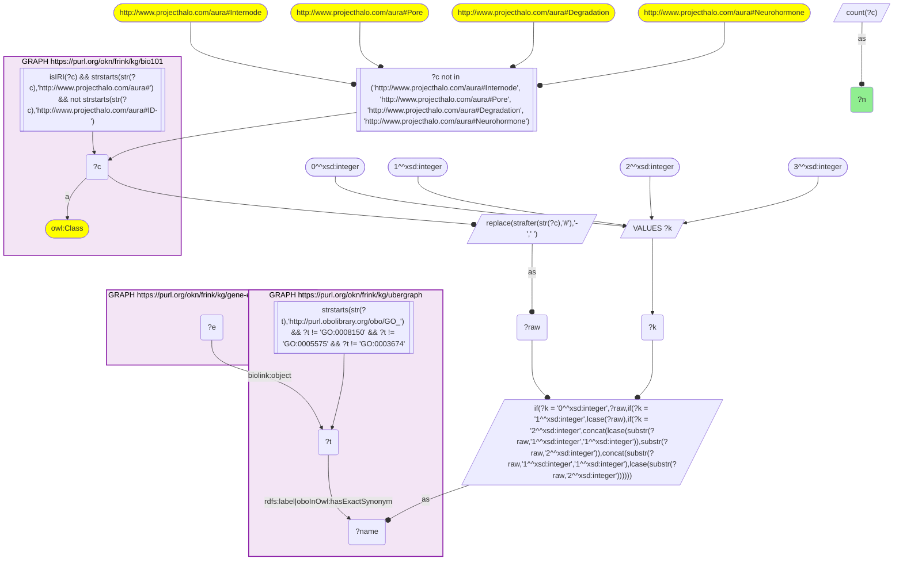
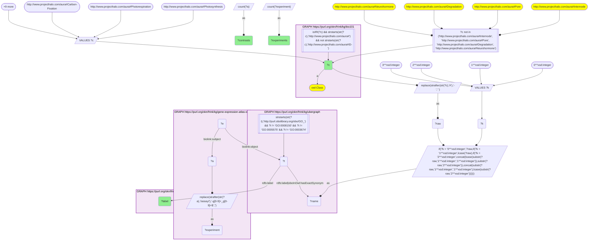
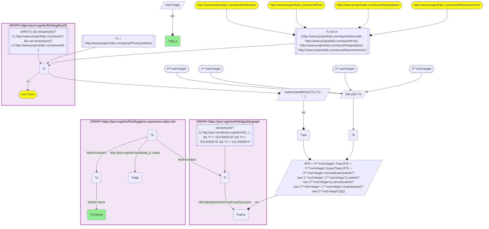

# MF05-Q2: Textbook plant processes in Expression Atlas experiments

- **Date:** 2026-11-03
- **Model:** claude-opus-5-5
- **SPARQL endpoint:** https://apps.okn.us/federation/sparql
- **Generated by:** mcp-okn v0.3.0 (build 5f97869)
- **Contents:** 3 queries · 3 query diagrams

## Knowledge graphs used

- `bio101` — <https://purl.org/okn/frink/kg/bio101>
- `ubergraph` — <https://purl.org/okn/frink/kg/ubergraph>
- `gene-expression-atlas-okn` — <https://purl.org/okn/frink/kg/gene-expression-atlas-okn>

## Conversation

👤 **User**

Crosswalk: `bio101` × `gene-expression-atlas-okn` on **GO (bio101 label), bridged through `ubergraph`** (crosswalk `KB18-go-label-bio101-gxa`, verified_count 193). KB Bio 101 is an OWL ontology of an introductory biology textbook: every concept is an `owl:Class` IRI `http://www.projecthalo.com/aura#{Name}` with no `rdfs:label` and no external id, so the concept NAME (local name, hyphens → spaces, four case forms: as-is, all lower-case, first letter lowered, sentence case) is matched as a bound literal against ubergraph `rdfs:label | oboInOwl:hasExactSynonym` on `obo/GO_` terms. Expression Atlas (`gene-expression-atlas-okn`) stores GO enrichment of each differential-expression contrast as a `biolink:Association` whose `biolink:subject` is the contrast (`biolink:Assay`, named `'test' vs 'reference'` on `biolink:name`), whose `biolink:object` is a raw `obo/GO_` IRI, with `wobd:p_value` and `wobd:adj_p_value` (`wobd:direction` is 'up' on every enrichment in this release). The experiment accession is the contrast IRI's prefix (`wobd/assay/E-GEOD-69785-g1_g4` → `E-GEOD-69785`).

Research question: for the plant processes and structures KB Bio 101 teaches (photosynthesis, photorespiration, carbon fixation, gravitropism, phototropism, photomorphogenesis, flower development, systemic acquired resistance, the photosystems, chloroplast, thylakoid), in how many Expression Atlas contrasts and experiments are they enriched, and which experimental comparisons enrich photosynthesis most strongly?

Why the join is required: the textbook's plant processes are concepts without identifiers; only the name → GO bridge through ubergraph reaches Expression Atlas's enrichment records.

---

🧠 **Assistant**

**Bridge established (Query 1).** The crosswalk skeleton, run verbatim, returns **193** bio101 concepts that reach an Expression Atlas enrichment through the name → GO bridge, matching the catalogued `verified_count`. Query 2 restricts it to twelve plant processes and structures.

**The textbook's plant topics (Query 2).** All twelve bridge and are enriched somewhere:

| bio101 concept | GO label | Contrasts | Experiments |
|---|---|---|---|
| Photosystem-II | photosystem II | 453 | 232 |
| Photosystem-I | photosystem I | 438 | 213 |
| Photosynthesis | photosynthesis | 233 | 118 |
| Thylakoid | thylakoid | 112 | 68 |
| Systemic-Acquired-Resistance | systemic acquired resistance | 108 | 62 |
| Photorespiration | photorespiration | 52 | 29 |
| Carbon-Fixation | carbon fixation | 47 | 25 |
| Photomorphogenesis | photomorphogenesis | 18 | 12 |
| Chloroplast | chloroplast | 5 | 4 |
| Flower-Development | flower development | 5 | 4 |
| Phototropism | phototropism | 3 | 3 |
| Gravitropism | gravitropism | 1 | 1 |

**Strongest photosynthesis enrichments (Query 3).** These are the 25 contrasts with the lowest adjusted p-value for GO_0015979. They are mostly stress and immune challenges:

- **Pathogens and immune elicitors:**
  - *Rhizoctonia solani* on rice cultivars Cocodrie (adj. p 6.8 × 10⁻²⁹ at 1 day) and MCR10277;
  - the bacterial peptides flg22 (1.2 × 10⁻²⁸) and elf18;
  - *Moniliophthora perniciosa*;
  - *Pseudomonas syringae* pv. *maculicola*;
  - three *Xanthomonas oryzae* pv. *oryzicola* strains;
  - *Phytophthora infestans*;
  - *Neofusicoccum parvum*.
- **Abiotic stress:**
  - 100 mM sodium chloride in rice leaf (9.8 × 10⁻³¹);
  - abscisic acid under salt, in two root genotypes;
  - a drought time course (Nonabokra) and a watering time course;
  - 300 mM NaCl over time;
  - cadmium sulfate;
  - nitrogen deprivation.
- **Light and development:**
  - the top hit, 'light regimen' vs 'none' in 'E-L 31' (4.97 × 10⁻³³), with 'E-L 33' later in the list;
  - a nitrate pulse;
  - one mutant (hcr2) and one developmental-stage comparison.

**Answer.** The photosynthetic apparatus is the plant topic that most often changes between conditions. The two photosystems are enriched in over 400 contrasts each, and photosynthesis in 233 contrasts across 118 experiments. Photorespiration and carbon fixation follow at about 50 contrasts each.

The growth-response topics a textbook pairs with them are rare: photomorphogenesis has 18 contrasts, phototropism 3 and gravitropism 1. The "chloroplast" GO term itself is enriched in only 5, because experiments are annotated to its parts (thylakoid, photosystems) rather than to the organelle term.

The strongest photosynthesis signals come from pathogen and elicitor challenges and from salt, drought and cadmium stress. This fits the familiar trade-off in which a stressed or infected plant re-tunes its photosynthetic genes.

Caveats:

- Every Expression Atlas enrichment carries `wobd:direction` "up", so these rows cannot show whether photosynthesis genes were induced or repressed. Only the fact of enrichment is recorded.
- Query 3 ranks contrasts by name, keeping the minimum adjusted p per name.
- Counts are an exact-name lower bound (the GO roots and four homonyms are excluded).

## SPARQL queries executed

#### Query 1

_2026-11-04T01:00:49+00:00 · `bio101`, `ubergraph`, `gene-expression-atlas-okn`_

```sparql
SELECT (COUNT(DISTINCT ?c) AS ?n) WHERE {
  { SELECT DISTINCT ?c ?t WHERE {
  { SELECT DISTINCT ?c ?name WHERE {
      GRAPH <https://purl.org/okn/frink/kg/bio101> { ?c a <http://www.w3.org/2002/07/owl#Class> .
        FILTER(isIRI(?c) && STRSTARTS(STR(?c),'http://www.projecthalo.com/aura#') && !STRSTARTS(STR(?c),'http://www.projecthalo.com/aura#ID-')) }
      FILTER(?c NOT IN (<http://www.projecthalo.com/aura#Internode>, <http://www.projecthalo.com/aura#Pore>, <http://www.projecthalo.com/aura#Degradation>, <http://www.projecthalo.com/aura#Neurohormone>))  # homonyms (spot-checked 2026-11-03)
      BIND(REPLACE(STRAFTER(STR(?c),'#'),'-',' ') AS ?raw)
      VALUES ?k { 0 1 2 3 }  # as-is, all lower, first letter lowered, sentence case
      BIND(IF(?k = 0, ?raw, IF(?k = 1, LCASE(?raw), IF(?k = 2, CONCAT(LCASE(SUBSTR(?raw,1,1)),SUBSTR(?raw,2)),
                CONCAT(SUBSTR(?raw,1,1),LCASE(SUBSTR(?raw,2)))))) AS ?name)
  } }
    GRAPH <https://purl.org/okn/frink/kg/ubergraph> { ?t <http://www.w3.org/2000/01/rdf-schema#label>|<http://www.geneontology.org/formats/oboInOwl#hasExactSynonym> ?name .
      FILTER(STRSTARTS(STR(?t),'http://purl.obolibrary.org/obo/GO_') && ?t != <http://purl.obolibrary.org/obo/GO_0008150> && ?t != <http://purl.obolibrary.org/obo/GO_0005575> && ?t != <http://purl.obolibrary.org/obo/GO_0003674>) }
  } }
  GRAPH <https://purl.org/okn/frink/kg/gene-expression-atlas-okn> { ?e <https://w3id.org/biolink/vocab/object> ?t . }
}
```



_1 row(s)_

| n |
| --- |
| 193 |

#### Query 2

_2026-11-04T01:00:49+00:00 · `bio101`, `ubergraph`, `gene-expression-atlas-okn`_

```sparql
SELECT ?c ?label (COUNT(DISTINCT ?a) AS ?contrasts) (COUNT(DISTINCT ?experiment) AS ?experiments) WHERE {
  { SELECT DISTINCT ?c ?t WHERE {
  { SELECT DISTINCT ?c ?name WHERE {
      GRAPH <https://purl.org/okn/frink/kg/bio101> { ?c a <http://www.w3.org/2002/07/owl#Class> .
        FILTER(isIRI(?c) && STRSTARTS(STR(?c),'http://www.projecthalo.com/aura#') && !STRSTARTS(STR(?c),'http://www.projecthalo.com/aura#ID-')) }
      FILTER(?c NOT IN (<http://www.projecthalo.com/aura#Internode>, <http://www.projecthalo.com/aura#Pore>, <http://www.projecthalo.com/aura#Degradation>, <http://www.projecthalo.com/aura#Neurohormone>))  # homonyms (spot-checked 2026-11-03)
      BIND(REPLACE(STRAFTER(STR(?c),'#'),'-',' ') AS ?raw)
      VALUES ?k { 0 1 2 3 }  # as-is, all lower, first letter lowered, sentence case
      BIND(IF(?k = 0, ?raw, IF(?k = 1, LCASE(?raw), IF(?k = 2, CONCAT(LCASE(SUBSTR(?raw,1,1)),SUBSTR(?raw,2)),
                CONCAT(SUBSTR(?raw,1,1),LCASE(SUBSTR(?raw,2)))))) AS ?name)
  } }
    GRAPH <https://purl.org/okn/frink/kg/ubergraph> { ?t <http://www.w3.org/2000/01/rdf-schema#label>|<http://www.geneontology.org/formats/oboInOwl#hasExactSynonym> ?name .
      FILTER(STRSTARTS(STR(?t),'http://purl.obolibrary.org/obo/GO_') && ?t != <http://purl.obolibrary.org/obo/GO_0008150> && ?t != <http://purl.obolibrary.org/obo/GO_0005575> && ?t != <http://purl.obolibrary.org/obo/GO_0003674>) }
  } }
  VALUES ?c { <http://www.projecthalo.com/aura#Photosynthesis> <http://www.projecthalo.com/aura#Photorespiration> <http://www.projecthalo.com/aura#Carbon-Fixation> <http://www.projecthalo.com/aura#Gravitropism> <http://www.projecthalo.com/aura#Phototropism> <http://www.projecthalo.com/aura#Photomorphogenesis> <http://www.projecthalo.com/aura#Flower-Development> <http://www.projecthalo.com/aura#Systemic-Acquired-Resistance> <http://www.projecthalo.com/aura#Photosystem-I> <http://www.projecthalo.com/aura#Photosystem-II> <http://www.projecthalo.com/aura#Chloroplast> <http://www.projecthalo.com/aura#Thylakoid> }
  GRAPH <https://purl.org/okn/frink/kg/gene-expression-atlas-okn> { ?e <https://w3id.org/biolink/vocab/object> ?t ; <https://w3id.org/biolink/vocab/subject> ?a . BIND(REPLACE(STRAFTER(STR(?a), '/assay/'), '-g[0-9]+_g[0-9]+$', '') AS ?experiment) }
  GRAPH <https://purl.org/okn/frink/kg/ubergraph> { ?t <http://www.w3.org/2000/01/rdf-schema#label> ?label }
} GROUP BY ?c ?label ORDER BY DESC(?contrasts) ?c
```



_12 row(s) — showing first 3_

| c | label | contrasts | experiments |
| --- | --- | --- | --- |
| http://www.projecthalo.com/aura#Photosystem-II | photosystem II | 453 | 232 |
| http://www.projecthalo.com/aura#Photosystem-I | photosystem I | 438 | 213 |
| http://www.projecthalo.com/aura#Photosynthesis | photosynthesis | 233 | 118 |

#### Query 3

_2026-11-04T01:00:50+00:00 · `bio101`, `ubergraph`, `gene-expression-atlas-okn`_

```sparql
SELECT ?contrast (MIN(?adjp) AS ?adj_p) WHERE {
  { SELECT DISTINCT ?c ?t WHERE {
  { SELECT DISTINCT ?c ?name WHERE {
      GRAPH <https://purl.org/okn/frink/kg/bio101> { ?c a <http://www.w3.org/2002/07/owl#Class> .
        FILTER(isIRI(?c) && STRSTARTS(STR(?c),'http://www.projecthalo.com/aura#') && !STRSTARTS(STR(?c),'http://www.projecthalo.com/aura#ID-')) }
      FILTER(?c NOT IN (<http://www.projecthalo.com/aura#Internode>, <http://www.projecthalo.com/aura#Pore>, <http://www.projecthalo.com/aura#Degradation>, <http://www.projecthalo.com/aura#Neurohormone>))  # homonyms (spot-checked 2026-11-03)
      BIND(REPLACE(STRAFTER(STR(?c),'#'),'-',' ') AS ?raw)
      VALUES ?k { 0 1 2 3 }  # as-is, all lower, first letter lowered, sentence case
      BIND(IF(?k = 0, ?raw, IF(?k = 1, LCASE(?raw), IF(?k = 2, CONCAT(LCASE(SUBSTR(?raw,1,1)),SUBSTR(?raw,2)),
                CONCAT(SUBSTR(?raw,1,1),LCASE(SUBSTR(?raw,2)))))) AS ?name)
  } }
    GRAPH <https://purl.org/okn/frink/kg/ubergraph> { ?t <http://www.w3.org/2000/01/rdf-schema#label>|<http://www.geneontology.org/formats/oboInOwl#hasExactSynonym> ?name .
      FILTER(STRSTARTS(STR(?t),'http://purl.obolibrary.org/obo/GO_') && ?t != <http://purl.obolibrary.org/obo/GO_0008150> && ?t != <http://purl.obolibrary.org/obo/GO_0005575> && ?t != <http://purl.obolibrary.org/obo/GO_0003674>) }
  } }
  FILTER(?c = <http://www.projecthalo.com/aura#Photosynthesis>)
  GRAPH <https://purl.org/okn/frink/kg/gene-expression-atlas-okn> { ?e <https://w3id.org/biolink/vocab/object> ?t ; <https://w3id.org/biolink/vocab/subject> ?a ; <http://purl.org/okn/wobd/adj_p_value> ?adjp . ?a <https://w3id.org/biolink/vocab/name> ?contrast . }
} GROUP BY ?contrast ORDER BY ?adj_p LIMIT 25
```



_25 row(s) — showing first 5_

| contrast | adj_p |
| --- | --- |
| 'light regimen' vs 'none' in 'E-L 31' | 4.97497e-33 |
| 'sodium chloride; 100 millimolar' vs 'none' in 'Vialone Nano; leaf' | 9.84283e-31 |
| 'Rhizoctonia solanii; 1 day' vs 'none; 0 day' in 'Cocodrie' | 6.82521e-29 |
| 'flg22 treatment' vs 'control' | 1.22761e-28 |
| '2hr continuous KNO3' vs 'control' in 'epidermis and cortex' | 1.4137e-28 |
