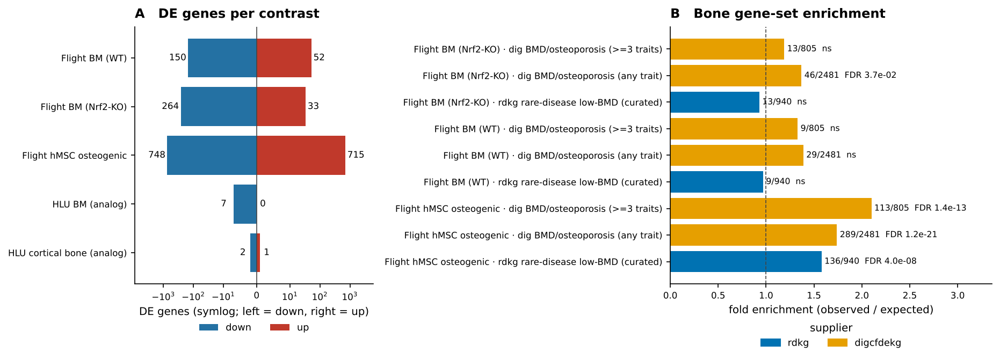
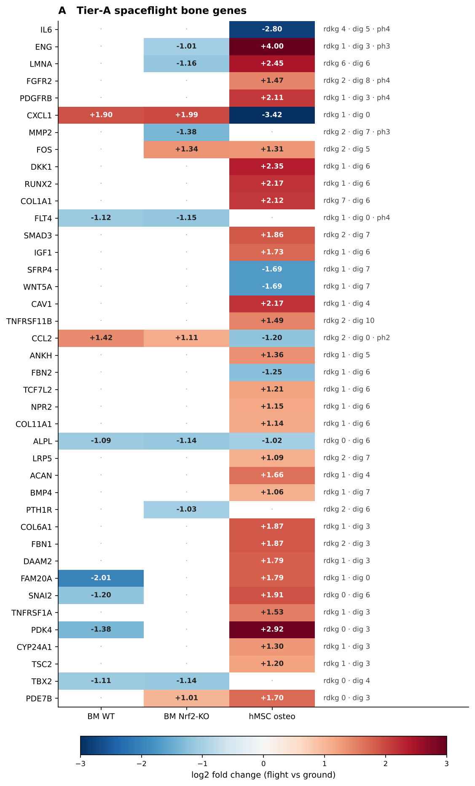
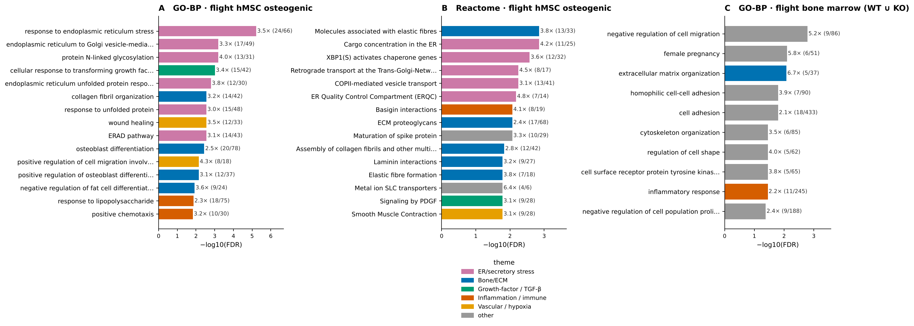
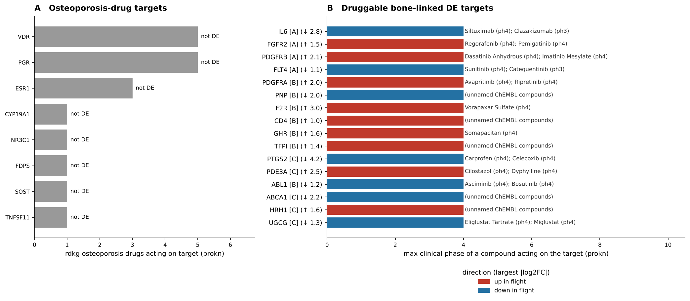
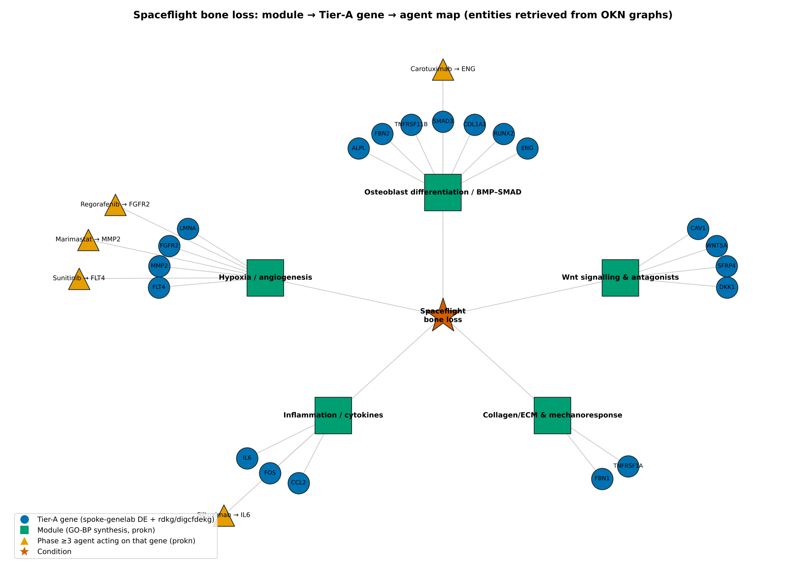

# Spaceflight-Induced Bone Loss: an Integrative Cross-Knowledge-Graph Study
### Spaceflight and analog transcriptomics (spoke-genelab) integrated with rare-disease, GWAS, pathway, drug and biomarker graphs of the OKN federation

**Date:** 2026-11-19 · **Endpoint:** OKN federated SPARQL (mcp-okn 0.6.3) · **Model:** claude-opus-5-5

> **Framing (non-negotiable).** Unit of analysis = human genes (mouse genes projected to human orthologs) differentially expressed in 3 vetted spaceflight-vs-ground contrasts and 2 hindlimb-unloading analog contrasts, cross-referenced with bone-disorder gene sets, pathways, drug–target edges and biomarkers. The level of inference is **hypothesis generation**: rodent and cell-culture transcriptomes, ortholog-inferred, joined to observational / curated associations. Nothing here is a causal or clinical claim; keep that caveat attached to every downstream statement.

**Abbreviations.** BM = bone marrow; BMD = bone mineral density; BMP = bone morphogenetic protein; DE = differentially expressed; ECM = extracellular matrix; ER = endoplasmic reticulum; FDR = false-discovery rate (Benjamini–Hochberg); GO-BP = Gene Ontology biological process; GWAS = genome-wide association study; HLU = hindlimb unloading; HP = Human Phenotype Ontology; hMSC = human mesenchymal stem/stromal cell; KG = knowledge graph; KO = knockout; log2FC = log2 fold change; MONDO = Mondo Disease Ontology; OKN = Open Knowledge Network; OSD = NASA Open Science Data Repository study; ph = clinical phase; SF = spaceflight; UPR = unfolded protein response; WT = wild type.

## 1. Executive summary

Integrating NASA GeneLab spaceflight transcriptomes with the federation's bone-disease, pathway and drug graphs shows that the **osteogenic human mesenchymal stem cell (hMSC) spaceflight signature is strongly enriched for human bone-mass genes**: **113** of its genes carry recurrent BMD/osteoporosis GWAS-style evidence in digcfdekg (**2.1×** expected, FDR 1.4e-13), and **136** are genes of rare diseases with an osteoporosis / osteopenia / low-BMD phenotype in rdkg (**1.58×**, FDR 4.0e-08). The mouse whole-bone-marrow flight signatures (WT and Nrf2-KO) carry no comparable enrichment, and the hindlimb-unloading analog contrasts in the federation are nearly empty (3 and 7 DE genes).

The enriched biology falls into a few modules — **osteoblast differentiation / BMP–SMAD** (RUNX2, COL1A1, BMP4, SMAD3, ALPL), **Wnt antagonism** (DKK1 up; SFRP4, WNT5A and, in marrow, WIF1 down), **collagen / ECM and mechanoresponse**, **inflammation** (IL6, CCL2, CXCL1–3) and **ER / secretory stress** (63 GO-BP and 41 Reactome terms at FDR < 0.05 in the hMSC signature). **ALPL** (alkaline phosphatase, the hypophosphatasia gene) is the only gene down-regulated in all three flight contrasts.

Of **446** bone-linked spaceflight DE genes, **40** reach Tier A (multiply corroborated). None of the eight targets of the **41** DrugBank osteoporosis drugs in rdkg is differentially expressed in flight; instead, flight perturbs their **pathway neighbours** — TNFRSF11B (osteoprotegerin, the endogenous decoy for denosumab's target RANKL), DKK1 / SFRP4 / LRP5 (the Wnt axis romosozumab acts on through sclerostin) and PTH1R (teriparatide's receptor). Repurposing leads from prokn (e.g. odanacatib → CTSK, anti-IL-6 antibodies → IL6) must be read with direction: two of the most druggable hits (IL6, PTGS2) are **down** in flight, so their inhibitors would push in the same direction as spaceflight, and the literature argues against COX-2 inhibition (§8).

## 2. Sources used

| KG | Version | Updated | Role in this study | Join key / confidence |
|---|---|---|---|---|
| spoke-genelab | v0.0.2 | 2026-03-13 | Spaceflight and HLU differential expression (OSD-690, OSD-546, OSD-467, OSD-214); mouse→human orthologs | Entrez (node IRI); contrasts vetted with `get_valid_contrasts` — high |
| rdkg | v0.0.1 | 2026-05-04 | Curated rare-disease low-BMD gene set; osteoporosis treatments (`treats`); osteoporosis phenotypes | Entrez (C6, identifiers.org/ncbigene rewrite); MONDO — high |
| digcfdekg | v0.0.1 | 2026-06-21 | Broad BMD / osteoporosis gene–trait sets (PIGEAN / EAGGL) | Entrez (C11, same IRI) — high |
| prokn | v0.0.6 | 2026-09-09 | GO-BP and Reactome membership; compound → protein target edges and clinical phase | HGNC symbol label (string match) — medium |
| babel | v0.0.1 | 2026-08-23 | DrugBank ↔ ChEMBL bridge for rdkg drugs → prokn compounds | clique `skos:exactMatch` (DB2) — high |
| ubergraph | v0.0.2 | 2026-05-01 | Term look-up, MONDO subclass closure, GO / HP labels | OBO IRIs — high |
| spoke-okn | v0.0.6 | 2026-03-16 | Checked for bone-disease gene associations (only osteoarthritis present) | Entrez — negative result |
| biomarkerkg | v0.0.4 | 2026-10-09 | Osteoporosis biomarkers (variant-level) | MONDO (ubergraph closure) — medium |

## 3. Design & rules

**Contrasts.** All 680 Space-Flight-vs-Ground-Control assays in spoke-genelab were screened with the server's contrast vetting (3 bone-relevant clean contrasts kept): mouse **bone marrow** from the JAXA MHU-3 mission in wild-type and **Nrf2-knockout** animals (OSD-690; same genotype on both arms), and **human MSCs cultured in osteogenic medium** on the ISS (OSD-546). Two terrestrial **analog** contrasts were added: mouse **cortical bone** (OSD-467) and **bone marrow** (OSD-214, no immunisation arms) after hindlimb unloading versus normal loading. The federation holds no femur, tibia, calvaria or osteoclast spaceflight transcriptome; cartilage was only available from a parabolic-flight study and was not used.

**Differential expression** used the skill's standard call (adjusted p ≤ 0.05 and |log2FC| ≥ 1), with mouse genes projected to human orthologs inside spoke-genelab and many-to-one collisions collapsed to the largest |log2FC|. **Bone-disorder gene sets** came from two suppliers chosen for contrast: rdkg (curated rare-disease genes of diseases annotated with HP Osteoporosis, Osteopenia or Reduced bone mineral density; 940 genes) and digcfdekg (GWAS-style BMD and osteoporosis traits; 2481 genes, 805 linked to ≥3 traits). Enrichment used the hypergeometric test against each supplier's explicit universe, with BH-FDR. **Pathways** were tested in both GO-BP and Reactome through prokn. **Drugs** were taken from rdkg `treats` (osteoporosis and its MONDO subtypes), bridged through babel to prokn targets, and separately from prokn compound → protein edges on the candidate genes. The exact replicator specification is in the reproducibility notebook (§11).

| Contrast | Tissue / system | Organism | DE genes | up | down |
|---|---|---|---|---|---|
| SF_BM_WT (OSD-690) | bone marrow, flight vs ground | mouse → human | 202 | 52 | 150 |
| SF_BM_Nrf2KO (OSD-690) | bone marrow, flight vs ground | mouse → human | 297 | 33 | 264 |
| SF_hMSC_osteo (OSD-546) | MSC, osteogenic medium, flight vs ground | human | 1463 | 715 | 748 |
| HLU_BM (OSD-214) | bone marrow, unloaded vs loaded | mouse → human | 7 | 0 | 7 |
| HLU_cortical (OSD-467) | cortical bone, unloaded vs loaded | mouse → human | 3 | 1 | 2 |

The flight contrasts carry most of the signal; the two analog contrasts are too sparse for enrichment and are used only as a cross-check (no Tier-A gene is DE in them).



> ***Figure 1. Contrast inventory and bone-gene-set enrichment.*** **(A)** Number of DE genes (adj p ≤ 0.05, |log2FC| ≥ 1; human Entrez after ortholog projection) per contrast, split into down (left, blue) and up (right, red); symmetric-log axis. **(B)** Fold enrichment (observed / expected) of each flight signature for the curated rdkg low-BMD rare-disease set (blue) and the broad digcfdekg BMD/osteoporosis sets (orange), annotated with overlap / set size and BH-FDR (ns = FDR ≥ 0.05). Background = each supplier's gene universe; n = DE genes inside it, counted server-side. Provenance: spoke-genelab reified `MEASURED_DIFFERENTIAL_EXPRESSION_ASmMG` + `IS_ORTHOLOG_MGiG`; rdkg `has_phenotype` / `related_to`; digcfdekg `geneToTrait`.

The osteogenic hMSC signature is enriched for bone genes from both suppliers — the curated set (the discriminating test) as well as the broad GWAS set — whereas whole-marrow flight signatures are at most marginally enriched for the broad set, consistent with marrow being dominated by haematopoietic cells.

## 4. Confidence tiers

| Tier | Requirement | Genes |
|---|---|---|
| A | DE in flight **and** (rdkg low-BMD gene **and** ≥3 digcfdekg BMD traits), **or** DE in ≥2 flight contrasts with rdkg or ≥3-trait digcfdekg support | 40 |
| B | DE in flight with rdkg or ≥3-trait digcfdekg support, or DE in ≥2 flight contrasts with any digcfdekg support | 212 |
| C | DE in flight with 1–2 digcfdekg traits only | 194 |

Within tiers genes are ranked by a 0–5 score summing recurrence across flight contrasts, effect size, Mendelian (rdkg) support, GWAS (digcfdekg) support and druggability (prokn clinical phase, or target of an rdkg osteoporosis drug). 12 of the 40 Tier-A genes are DE in two or more flight contrasts.

## 5. Findings by axis

### 5.1 Spaceflight gene signal and cross-contrast recurrence

Across the three flight contrasts, **1865** human genes are DE; **87** recur in ≥2 contrasts and **10** in all three. Only **1** of those ten (ALPL, down) moves the same way in the in-vivo marrow and the in-vitro hMSC; the chemokines CXCL1, CXCL2, CXCL3 and CCL2 rise in flight marrow but fall in flight hMSC, and IGFBP5, CCN5 and MAP1A do the reverse. The two marrow genotypes agree closely with each other (WIF1, FLT4, TBX2, ALPL all down in both), and Nrf2 loss enlarges the flight response (297 vs 202 DE genes).



> ***Figure 2. Tier-A spaceflight bone genes.*** Heat map of log2FC (flight vs ground; red = up, blue = down, "·" = not DE) for the 40 Tier-A genes in the three flight contrasts, ordered by integrated score. Right-hand notes: number of rdkg rare low-BMD diseases linking the gene, number of digcfdekg BMD/osteoporosis traits, and the highest clinical phase of any prokn compound acting on its protein (ph). Provenance: spoke-genelab (DE), rdkg (q12), digcfdekg (q15), prokn (q29).

Most Tier-A genes are carried by the osteogenic hMSC contrast, where osteoblast and matrix genes (RUNX2, COL1A1, BMP4, SMAD3, IGF1, LRP5) are up, while the Wnt modulators SFRP4 and WNT5A are down and DKK1 is up. In vivo, the marrow contributes ALPL, PTH1R, WIF1 and the chemokines, so the two systems implicate the same pathways through different genes.

### 5.2 Bone-disorder genetics

The curated rdkg low-BMD set is the discriminating test (Figure 1B): it is enriched only in the hMSC signature. Tier-A genes include Mendelian bone-fragility genes (COL1A1 and LMNA each link to ≥6 rdkg low-BMD diseases; LRP5, PTH1R, FBN1, SMAD3, TNFRSF11B to two). rdkg's osteoporosis disease family is annotated with renal phosphate wasting, hypophosphatemia, hyperphosphaturia and nephrolithiasis (each in two osteoporosis subtypes) alongside fracture susceptibility — the same mineral-handling axis as the kidney-stone risk of astronauts (q27). biomarkerkg lists 12 osteoporosis biomarkers, all germline SNPs (e.g. rs784288, rs13182402); none is an expression or serum marker that could be read from these transcriptomes.

## 6. Domain analyses

### 6.1 Functional enrichment (GO-BP and Reactome)

Both enrichment families were run on two signatures (hMSC osteogenic; marrow WT ∪ KO). GO molecular function and cellular component were deliberately skipped: the question is about programmes, not localisation. Significant terms (FDR < 0.05): hMSC — 63 GO-BP and 41 Reactome; marrow — 10 GO-BP and 1 Reactome.



> ***Figure 3. Functional enrichment of flight signatures.*** Top 15 terms by significance (−log10 BH-FDR) for **(A)** GO-BP and **(B)** Reactome in the osteogenic hMSC flight signature, and **(C)** GO-BP in flight bone marrow (WT ∪ Nrf2-KO); bars annotated with fold and (k / term size K) and coloured by an analyst-assigned theme. Foreground n = signature genes with ≥1 annotation; background N = all prokn genes with ≥1 annotation (GO-BP N = 7,661; Reactome N = 6,032). GO-NOT annotations were removed. FDR is computed over the terms returned (k ≥ 5 GO, k ≥ 4 Reactome, 10 ≤ K ≤ 500 for GO). Provenance: prokn gene `SIO_010078` → protein → `actively_involved_in` (GO) or `participates_in` (Reactome R-HSA), joined to spoke-genelab by HGNC symbol.

The hMSC flight signature is dominated by **ER-to-Golgi trafficking, protein N-glycosylation and the unfolded protein response** together with **collagen-fibril, elastic-fibre and osteoblast-differentiation** terms — the secretory machinery an osteoblast uses to make matrix. Key UPR effectors (HSPA5/BiP, XBP1) are *down*, so the theme indicates a reduced secretory programme rather than an induced stress response. The marrow signature is weak and generic (adhesion, migration, inflammation).

### 6.2 Drugs, targets and repurposing

rdkg lists 84 treatment nodes for osteoporosis and its subtypes (41 DrugBank drugs, the rest trial-arm labels); through babel, prokn resolves direct protein targets for 18 of them, covering 8 proteins (VDR, PGR, ESR1, CYP19A1, NR3C1, FDPS, SOST, TNFSF11). Bisphosphonates other than minodronate, and teriparatide, have no prokn target edge.



> ***Figure 4. Therapeutic landscape.*** **(A)** Protein targets of rdkg osteoporosis drugs (prokn `directly_physically_interacts_with`, via babel DrugBank→ChEMBL), with the number of drugs per target; grey = not DE in any flight contrast. **(B)** Bone-linked flight DE genes whose protein is targeted by a compound of clinical phase ≥ 3 in prokn (bar = maximum phase; label = gene [tier] (direction and largest |log2FC|); annotation = up to two named agents). Colour = direction of the largest flight change. Evidence layer: approved / late-stage drugs (phase 3–4), not toxicogenomic perturbations.

No current osteoporosis-drug target is transcriptionally altered in these flight data, so the federation's bridge to countermeasures runs through pathway neighbours (TNFRSF11B for RANKL, DKK1 / SFRP4 / LRP5 for the sclerostin–Wnt axis, PTH1R for teriparatide). Of 446 bone-linked DE genes, 28 are hit by a phase ≥3 compound (16 by an approved one); the plausible repurposing leads are those where inhibition opposes the flight change — CTSK (up; odanacatib, phase 3), PDGFRB / FGFR2 (up; tyrosine-kinase inhibitors, with obvious toxicity limits) — whereas IL6 and PTGS2 are down in flight, so their inhibitors would reinforce the flight change.

### 6.3 Mechanistic map



> ***Figure 5. Mechanistic map of spaceflight bone loss.*** Anchor (star) → modules (squares) → Tier-A genes (circles) → phase ≥3 agents acting on those genes (triangles). Modules are an **analyst synthesis**: each Tier-A gene is placed in the theme where it carries the most prokn GO-BP annotations among the enriched bone-relevant terms (q31; ties to the earlier module; up to seven genes per module by score). Agents are drawn only where a prokn compound → protein edge ties them to a gene in that module. Provenance: spoke-genelab, rdkg, digcfdekg (genes); prokn (modules, agents).

The map places the osteoblast / BMP module at the centre of the signal, flanked by Wnt antagonism and ECM / mechanoresponse; the inflammation and angiogenesis modules carry most of the druggable nodes, which is where repurposing has to be weighed against direction of effect (§6.2).

**Analyses run and deliberately skipped.** Run: DE (5 contrasts); curated and broad disease/trait enrichment; GO-BP; Reactome; HP phenotypes (rdkg); drug→target (rdkg + babel + prokn) and target→drug (prokn); biomarkers (biomarkerkg). Skipped: **oard-kg phenotypes** — osteoporosis (MONDO_0005298) is absent from this rare-disease EHR graph (exploratory probe); **spoke-okn drug and gene layers** — its 180 diseases include osteoarthritis but no osteoporosis (q13); **DNA methylation and microbiome** (spoke-genelab) — no bone-tissue methylation contrast exists and the microbiome is outside the question; **gene-expression-atlas / nde** human bed-rest or immobilisation datasets — not pursued here and listed as a gap; **biobricks-aopwiki / tox** — the harmful-exposure direction is not the question; **pankgraph, nestkg, glygenkg, ncipidkg** — pancreas / cancer / glycan / pathway-interaction scopes, with GO and Reactome already supplied by prokn; **place-based linkage** — not a spatial question.

## 7. Discussion

Three layers agree. Spaceflight perturbs the **osteoblast lineage** (ALPL loss in every flight contrast; the osteogenic hMSC signature concentrated in BMD and Mendelian bone-fragility genes), the **Wnt-antagonist axis** that sclerostin-targeted therapy exploits (DKK1 up, WIF1 / SFRP4 down), and **matrix secretion** (collagen, glycosylation and ER–Golgi trafficking terms with UPR effectors down). Inflammation is the main conflict: marrow chemokines rise in flight while the same genes fall in cultured hMSC, so the in-vivo inflammatory milieu is not reproduced by flown cell culture.

For countermeasures the federation supports antiresorptive and anabolic agents only indirectly: their targets are not transcriptionally altered, but their pathways are. **Testable predictions:** (i) ALPL activity and bone-specific alkaline phosphatase should fall in flown animals' marrow stromal fractions irrespective of Nrf2 status; (ii) DKK1 neutralisation (or sclerostin antibody) should rescue the osteogenic hMSC flight signature more than RANKL blockade, which acts downstream of the osteoblast defect; (iii) cathepsin-K inhibition should blunt the matrix-degradation arm (CTSK up, collagen-degradation Reactome terms enriched) in an unloading model; (iv) COX-2 inhibitors should *worsen* unloading bone loss given that PTGS2 is down in flight.

## 8. Comparison with prior work

According to PubMed and the Paperclip full-text corpus, each central claim was compared with the primary literature; the per-claim record is in [Spaceflight-Bone-Loss_literature_comparison.md](Spaceflight-Bone-Loss_literature_comparison.md).

| # | Claim | Concordance |
|---|---|---|
| 1 | Spaceflight suppresses osteoblast-lineage programmes in marrow progenitors (ALPL down in all three flight contrasts; osteoblast-differentiation terms enriched) | **PARTIALLY SUPPORTED** — simulated microgravity inhibits osteogenic differentiation of human marrow MSCs [2] and lowers bone-development genes [4]; but many osteogenic genes (RUNX2, COL1A1, BMP4) are *up* in the flown osteogenic hMSC here |
| 2 | The flown hMSC signature is dominated by ECM and ER / secretory-stress programmes, with UPR effectors (HSPA5, XBP1) down | **PARTIALLY SUPPORTED** — ISS-flown MSCs show ECM-organisation changes [3]; clinostat raises ER-stress markers in pre-osteoblasts [11], the opposite direction to the UPR genes here |
| 3 | The Wnt-antagonist axis (DKK1 up; WIF1, SFRP4 down) links unloading to reduced bone formation | **SUPPORTED** — bed rest raises serum sclerostin with a DKK1 trend [5]; suppressing sclerostin rescues unloading bone loss [6]; sclerostin / DKK1 antibodies are established anabolic strategies [13] |
| 4 | IL-6 (Tier A; approved antagonist siltuximab) is a countermeasure target | **MIXED** — IL-6 receptor blockade did not prevent unloading bone loss in mice [7]; IL-6⁺ osteocytes fall in unloaded bone [8]; a review lists IL-6 antibody among agents reducing resorption [9]; IL6 is down in flight here |
| 5 | COX-2 inhibitors (approved, acting on PTGS2) are repurposing candidates | **CONTRADICTED** — reduced PGE2 interoceptive signalling drives unloading bone loss [10] and PGE2 release is anabolic [6]; PTGS2 is down 4.2 log2 units in flight, so COX-2 inhibition would reinforce the deficit |
| 6 | Antiresorptive osteoporosis drugs (bisphosphonates, denosumab) are relevant countermeasures although their targets are not DE in flight | **SUPPORTED** — alendronate with resistive exercise prevented BMD loss in ISS crew [1]; reviews document bisphosphonate and RANKL-antibody efficacy [9,14] |
| 7 | Cathepsin K (CTSK up; odanacatib, phase 3) is a spaceflight repurposing lead | **NOVEL** — odanacatib was developed for osteoporosis [13], but no spaceflight or unloading test was found in the search |
| 8 | Nrf2 deficiency amplifies the marrow spaceflight response (more DE genes, chemokines up) | **SUPPORTED** — Nrf2-KO mice on MHU-3 showed stronger flight-induced inflammation and immunosuppression [12] |
| 9 | The federation's hindlimb-unloading bone transcriptomes are nearly empty (3 and 7 DE genes) | **NOVEL** — a KG coverage observation; unloading itself robustly alters osteocyte signalling and bone mass [6,8] |
| 10 | In-vivo marrow and flown hMSC move 9 of 10 shared genes in opposite directions (chemokines up in marrow, down in hMSC) | **NOVEL** — no source found comparing these two systems |

All central claims were checked against abstracts; none was verified against full text in this run.

**Where the KG evidence diverges from the literature.** Claims 2, 4 and 5 are differences of **direction**, not of identity: the graphs correctly link the genes to bone, but a direction-blind drug–target join would rank COX-2 and IL-6 inhibitors as leads, which the literature argues against. Claim 9 is a **graph coverage gap** — unloading is a robust bone-loss model, so the sparse OSD-214 / OSD-467 signatures reflect the processed contrasts in spoke-genelab, not biology. The missing prokn targets for bisphosphonates (other than minodronate) and teriparatide are a **graph error of omission** (§6.2).

## 9. Full ranked results

The full candidate table is in `Spaceflight-Bone-Loss_results.xlsx` (sheet *Ranked Results*) and `data/ranked_candidates.tsv`. In the HTML report the table below is sortable, searchable and paginated; the pull-downs filter by tier, by number of flight contrasts and by direction in hMSC, and the `sources (n)` column counts the federation KGs supporting each gene (spoke-genelab = flight DE; rdkg = rare low-BMD disease gene; digcfdekg = BMD / osteoporosis trait gene; prokn = compound acting on the protein).

<!-- RESULTS_TABLE -->

| Rank | Gene | Tier | Flight contrasts | Key change | rdkg low-BMD diseases | digcfdekg traits | Max drug phase |
|---|---|---|---|---|---|---|---|
| 1 | IL6 | A | 1 | hMSC −2.80 | 4 | 5 | 4 |
| 2 | ENG | A | 2 | hMSC +4.00 | 1 | 3 | 3 |
| 3 | LMNA | A | 2 | hMSC +2.45 | 6 | 6 | — |
| 4 | FGFR2 | A | 1 | hMSC +1.47 | 2 | 8 | 4 |
| 5 | PDGFRB | A | 1 | hMSC +2.11 | 1 | 3 | 4 |
| 6 | CXCL1 | A | 3 | BM +1.9 / hMSC −3.42 | 1 | 0 | — |
| 9 | DKK1 | A | 1 | hMSC +2.35 | 1 | 6 | — |
| 18 | TNFRSF11B | A | 1 | hMSC +1.49 | 2 | 10 | — |
| 25 | ALPL | A | 3 | all three −1.0 to −1.1 | 0 | 6 | — |

The ranking rewards genes with genetic support from both suppliers and druggability, so signalling hubs (IL6, FGFR2, PDGFRB) score highest; ALPL, the most consistent flight change, ranks lower only because it lacks a drug edge and a rdkg low-BMD link in this release.

## 10. Summary of findings & limitations

Spaceflight transcriptomes in the OKN federation implicate the osteoblast lineage, Wnt antagonism and matrix secretion in bone loss: the osteogenic hMSC flight signature is enriched 2.1× for recurrent BMD/osteoporosis genes and 1.58× for Mendelian low-BMD genes, ALPL falls in every flight contrast, and 40 genes reach Tier A. Current osteoporosis drugs act on targets that are not transcriptionally altered but sit beside altered genes (TNFRSF11B, DKK1, PTH1R), and direction-aware reading of the druggable genes demotes COX-2 and IL-6 inhibition and leaves cathepsin-K inhibition as the most coherent untested repurposing lead.

**Limitations.**

1. Only three bone-relevant flight contrasts exist in spoke-genelab, two from one mouse mission (whole bone marrow, haematopoietic-dominated) and one from cultured human MSCs; there is no flown femur, tibia, osteocyte or osteoclast transcriptome.
2. The hindlimb-unloading contrasts are nearly empty, so the analog comparison is a coverage statement rather than a biological one.
3. Mouse genes are ortholog-projected to human; many-to-one collisions were collapsed to the largest |log2FC|.
4. DE thresholds (adj p ≤ 0.05, |log2FC| ≥ 1) were applied to processed GeneLab tables; study-level batch effects and small n are not modelled.
5. rdkg `related_to` gene–disease edges are broad; the curated set (940 genes) is larger than a strict Mendelian list.
6. digcfdekg gene–trait links are statistical inferences (PIGEAN / EAGGL), not causal genes.
7. GO / Reactome FDR was computed over the terms returned with k ≥ 4–5, which is less conservative than correcting over every term tested; the prokn join is a symbol string match.
8. prokn drug edges omit several osteoporosis drugs' targets (most bisphosphonates, teriparatide), and clinical phase is stored inconsistently (integer vs decimal).
9. Mechanistic-map modules are an analyst synthesis over GO annotations, not a query result.
10. The literature comparison used abstracts only; no claim was full-text verified.

## 11. Reproducibility

Everything needed to rerun the analysis — the originating prompt, the replicator specification, every supporting SPARQL query verbatim with the rows it returned, the analysis code and pinned KG versions — is in [Spaceflight-Bone-Loss_notebook/](Spaceflight-Bone-Loss_notebook/Spaceflight-Bone-Loss_notebook.ipynb); `Spaceflight-Bone-Loss_notebook/Spaceflight-Bone-Loss_notebook.html` shows it executed. Open it with:

```bash
cd Spaceflight-Bone-Loss/Spaceflight-Bone-Loss_notebook
uv run --with jupyterlab --with-requirements requirements.txt jupyter lab Spaceflight-Bone-Loss_notebook.ipynb
```

It opens on the session's logged rows; to rerun against the live graphs, uncomment `# RERUN = True` in its setup cell. Report-building scripts are in `scripts/`, extracts in `data/`.

## 12. References

> Retrieved via the **PubMed** MCP connector. Full-text verification via the **Paperclip** MCP connector.

1. Sibonga J, et al. Resistive exercise in astronauts on prolonged spaceflights provides partial protection against spaceflight-induced bone loss. *Bone*. 2019. PMID:31400472 · [doi:10.1016/j.bone.2019.07.013](https://doi.org/10.1016/j.bone.2019.07.013)
2. Li L, et al. Effects of simulated microgravity on the expression profiles of RNA during osteogenic differentiation of human bone marrow mesenchymal stem cells. *Cell Prolif*. 2019. PMID:30397970 · [doi:10.1111/cpr.12539](https://doi.org/10.1111/cpr.12539)
3. Huang P, et al. Impact of spaceflight on gene expression in cultured human mesenchymal stem/stromal cells. *PLoS One*. 2025. PMID:40080486 · [doi:10.1371/journal.pone.0315285](https://doi.org/10.1371/journal.pone.0315285)
4. Gershovich PM, et al. The effects of simulated microgravity on the pattern of gene expression in human bone marrow mesenchymal stem cells under osteogenic differentiation. *Fiziol Cheloveka*. 2013. PMID:25509878
5. Belavý DL, et al. Serum sclerostin and DKK1 in relation to exercise against bone loss in experimental bed rest. *J Bone Miner Metab*. 2016. PMID:26056021 · [doi:10.1007/s00774-015-0681-3](https://doi.org/10.1007/s00774-015-0681-3)
6. Zhao D, et al. Activation of connexin hemichannels enhances mechanosensitivity and anabolism in disused and aged bone. *JCI Insight*. 2024. PMID:39641271 · [doi:10.1172/jci.insight.177557](https://doi.org/10.1172/jci.insight.177557)
7. Wakabayashi H, et al. Functional block of interleukin-6 reduces a bone pain marker but not bone loss in hindlimb-unloaded mice. *Int J Mol Sci*. 2020. PMID:32429268 · [doi:10.3390/ijms21103521](https://doi.org/10.3390/ijms21103521)
8. Metzger CE, et al. Differential responses of mechanosensitive osteocyte proteins in fore- and hindlimbs of hindlimb-unloaded rats. *Bone*. 2017. PMID:28782619 · [doi:10.1016/j.bone.2017.08.002](https://doi.org/10.1016/j.bone.2017.08.002)
9. Baran R, et al. Microgravity-related changes in bone density and treatment options: a systematic review. *Int J Mol Sci*. 2022. PMID:35955775 · [doi:10.3390/ijms23158650](https://doi.org/10.3390/ijms23158650)
10. Guo Q, et al. Unloading-induced skeletal interoception alters hypothalamic signaling to promote bone loss and fat metabolism. *Adv Sci (Weinh)*. 2023. PMID:37880864 · [doi:10.1002/advs.202305042](https://doi.org/10.1002/advs.202305042)
11. Yoo YM, et al. Melatonin suppresses autophagy induced by clinostat in preosteoblast MC3T3-E1 cells. *Int J Mol Sci*. 2016. PMID:27070587 · [doi:10.3390/ijms17040526](https://doi.org/10.3390/ijms17040526)
12. Shimizu R, et al. Nrf2 alleviates spaceflight-induced immunosuppression and thrombotic microangiopathy in mice. *Commun Biol*. 2023. PMID:37626149 · [doi:10.1038/s42003-023-05251-w](https://doi.org/10.1038/s42003-023-05251-w)
13. Rachner TD, et al. Osteoporosis: now and the future. *Lancet*. 2011. PMID:21450337 · [doi:10.1016/S0140-6736(10)62349-5](https://doi.org/10.1016/S0140-6736%2810%2962349-5)
14. Iwamoto J, et al. Interventions to prevent bone loss in astronauts during space flight. *Keio J Med*. 2005. PMID:16077253 · [doi:10.2302/kjm.54.55](https://doi.org/10.2302/kjm.54.55)
